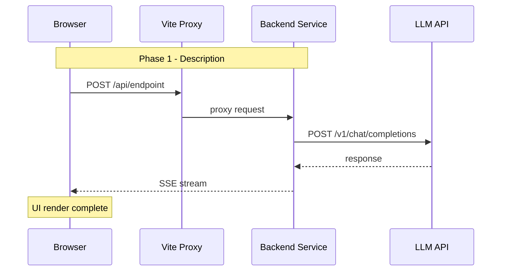

# Agent Debug Report Template (Mode B)

> 填写此模板生成结构化的 Agent/后端调试验证报告
> 基于 whitebox-verify v1.5 Mode B 六阶段法

---

## 0. Meta

| 字段 | 值 |
|------|-----|
| 日期 | YYYY-MM-DD |
| 验证人 | Claude Code (automated) |
| 目标服务 | `{container_name}:{port}` |
| 模型 | `{model_name}` |
| 约束 | 独立验收不修改源码、测试或配置；修复交回作者 |

---

## 1. 验证目标

```
一句话描述要验证什么（如: sessions_spawn 子 agent spawn 全链路）
```

**预期行为**: _描述正常情况下应该发生什么_

**异常现象**: _描述观察到的异常（如有）_

---

## 2. Config Audit (Phase 1)

### 2.1 配置文件清单

| # | 文件路径 | 审计项 | 期望值 | 实际值 | 结果 |
|---|---------|--------|--------|--------|------|
| 1 | `tools.json` | allowlist size | >= N | N | PASS/FAIL |
| 2 | `tools.json` | 包含 `{tool_name}` | yes | yes/no | PASS/FAIL |
| 3 | `application.yml` | `{key}` | `{value}` | `{value}` | PASS/FAIL |
| 4 | `docker-compose.yml` | `{env_var}` | `{value}` | `{value}` | PASS/FAIL |

### 2.2 Findings

| # | Severity | Finding | Fix Applied |
|---|----------|---------|-------------|
| 1 | P0/P1/P2 | 描述 | 修复内容 |

---

## 3. Startup Evidence (Phase 2)

```
粘贴关键启动日志:
- ToolFilter 输出
- 工具注册列表
- 初始化状态
```

**判定**: PASS / FAIL / PARTIAL

---

## 4. E2E Test Case (Phase 3)

### 4.1 Input

| 字段 | 值 |
|------|-----|
| 触发方式 | `curl` / `UI (Preview MCP)` |
| Endpoint | `POST {url}` |
| Request Body | ```json\n{...}\n``` |
| 触发时间 | `HH:MM:SS` |

### 4.2 Output (摘要)

```json
{
  "reply": "...",
  "sessionKey": "...",
  "status": "ok/error"
}
```

---

## 5. Log Evidence Chain (Phase 4)

> 所有日志必须来自同一次调用，时间戳一致

| Phase | 时间戳 | 关键日志证据 | 判定 |
|-------|--------|-------------|------|
| 4a OpenAI Schema | HH:MM:SS.mmm | `Converted tool to OpenAI format: {tool}` | PASS |
| 4b LLM tool_call | HH:MM:SS.mmm | `Streaming tool call chunk: id={call_id}, name={tool}` | PASS |
| 4c 中间件调度 | HH:MM:SS.mmm | `POST_REASONING → TOOL_CALL → PRE_ACTING` | PASS |
| 4d 实例化 | HH:MM:SS.mmm | `HarnessAgent '{name}' built [subagents=false]` | PASS |
| 4e 推理执行 | HH:MM:SS.mmm | `[{name}] PRE_REASONING → POST_REASONING` | PASS |
| 4f 汇总返回 | HH:MM:SS.mmm | `final reply` / `SSE done` | PASS |

**完整日志文件**: `/tmp/{debug_name}_full.log`

---

## 6. Dual Evidence Closure (Phase 5)

### 5.1 一致性校验

| 校验项 | 日志值 | 截图值 | 一致? |
|--------|--------|--------|-------|
| 时间戳 | HH:MM:xx | HH:MM:xx | ✅/❌ |
| Session Key | `{key}` | `{key}` | ✅/❌ |
| Call ID | `{id}` | `{id}` | ✅/❌ |
| 输出内容摘要 | `{text}` | `{text}` | ✅/❌ |

**判定**: PASS (全部一致) / FAIL (不一致项: ...)

### 5.2 UI Screenshot

**截图路径**: `docs/screenshots/{name}.png`

**截图关键信息标注**:

| 区域 | 内容 | 验证意义 |
|------|------|----------|
| 主要区域 | | |
| 次要区域 | | |
| 状态指示 | | |

---

## 7. Mermaid Sequence Diagram (Phase 6)



**绘图规范提醒**:
- [ ] 无 {} "" <> 在消息体中
- [ ] 无多层嵌套 <br/> 在 participant 名称中
- [ ] 复杂内容用 Note 替代消息箭头
- [ ] 本地预览后再提交

---

## 8. Naming Traceability (可选)

当运行时名称需要溯源时填写:

| 部分 | 值 | 来源 | 代码位置 |
|------|-----|------|----------|
| 前缀 | | LLM 选择 / 配置 / 硬编码 | |
| 后缀 | | 硬编码 / 拼接 / 动态 | |

**完整调用链**:

```
来源 A
  ↓
来源 B
  ↓
运行时名称: {name}
```

---

## 9. Verification Conclusion

| # | 验证项 | 证据 | 结果 |
|---|--------|------|------|
| 1 | | | PASS/FAIL |
| 2 | | | PASS/FAIL |
| ... | | | |

**总评**: PASS / FAIL / PARTIAL

**理由**: _一句话总结_

---

## 10. Raw Data Locations

| 数据 | 路径 |
|------|------|
| 容器完整日志 | `/tmp/{name}_full.log` |
| API 响应 JSON | `/tmp/{name}_response.json` |
| 配置文件快照 | `/tmp/{name}_config_snapshot.txt` |
| UI 截图 | `docs/screenshots/{name}.png` |
