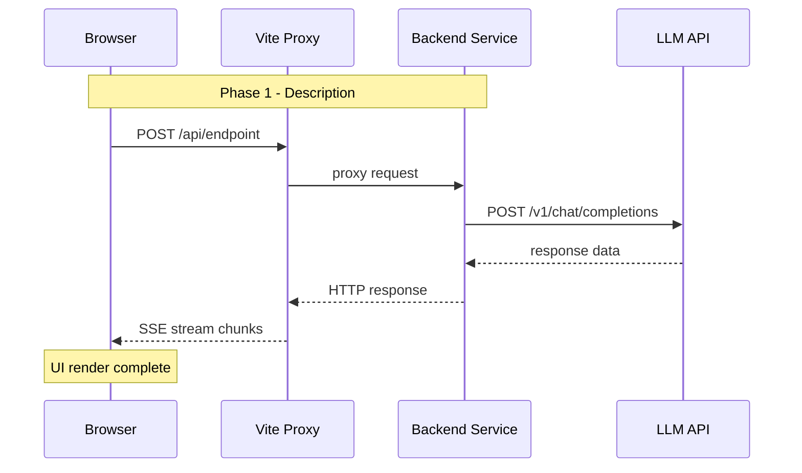

# Mermaid 时序图绘制规范

基于实战经验，Mermaid sequenceDiagram 的可用语法 subset:

## 可以用

- `participant` with simple names or `<br/>` (单层换行)
- `->>`, `-->>`, `->` 箭头
- `Note over/of/right/left` 注释框 (纯 ASCII 文本)
- `loop`, `alt`, `opt`, `par` 块结构
- `rect rgb(...)` 彩色背景块 (部分渲染器支持)

## 不能用 (会导致解析失败)

- 消息体中的 `{}` 大括号 (JSON 对象)
- 消息体中的 `""` 引号 (字符串引号)
- 消息体中的 `<>` 尖括号 (泛型/标签)
- 消息体中的 `\n` 换行符 (用空格或 Note 替代)
- 消息体中的 `|` 竖线 (表格字符)
- Note 中的 `┌─┐` `└─┘` 框线字符
- 嵌套的 `<br/>` 超过 1 层

## 最佳实践

```
✅ participant A as Browser<br/>Chrome
✅ Note over A,B: Phase 1 - 描述
✅ A->>B: 纯文本消息
✅ rect rgb(240,248,255) ... end (少量使用)

❌ A->>B: {key: "value"}       // {} 导致 parser 失败
❌ Note over A: |col1|col2|        // | 导致表格解析错乱
❌ participant A as Name<br/>(Sub)    // 多层嵌套 <br/> 不可靠
```

## 推荐模板


