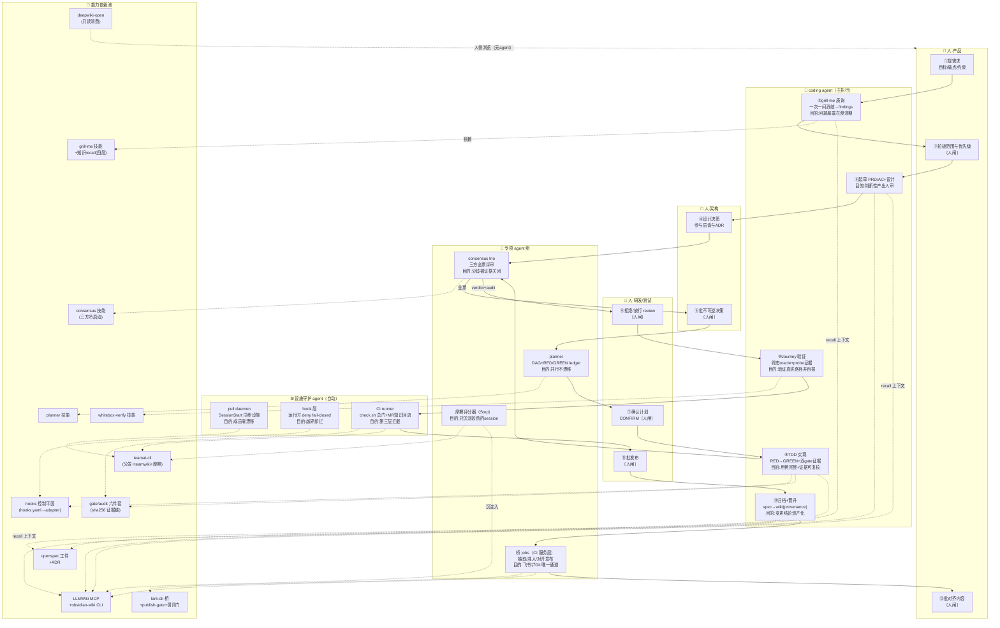
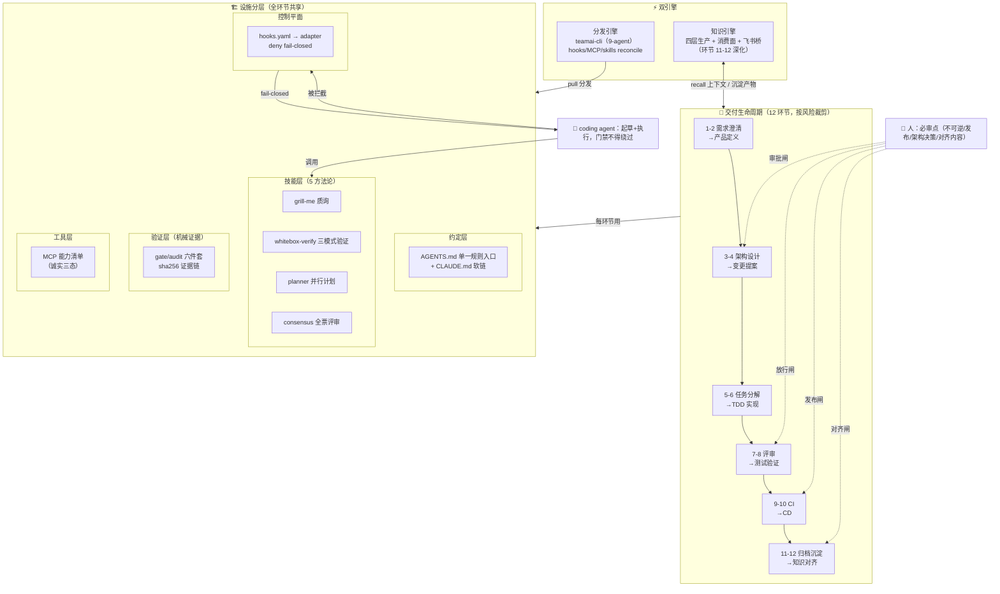
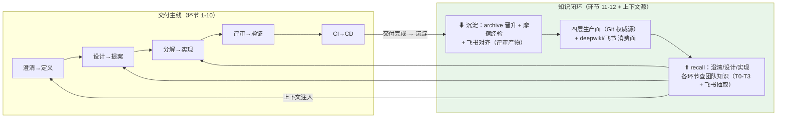

# AI DevOps 总体架构（权威总纲）

> 状态：**权威总纲**。本文定义整个 AI DevOps 架构——人机边界、交付生命周期（12 环节）、设施分层（五层 + 双引擎）、门禁与证据链。知识闭环是其中一个环节的深化视图（环节 11-12），详见 [knowledge-architecture.md](knowledge-architecture.md)。
> 原则（继承 ADR-0015）：**映射而非编排**。scaffold 提供每个环节的能力、门禁与人机边界；不规定阶段顺序，不造状态机。团队按变更风险裁剪环节。
> 文档矩阵：横向分层 [scaffold-architecture.md](scaffold-architecture.md) ｜ 知识环节深化 [knowledge-architecture.md](knowledge-architecture.md) ｜ 演进对齐+图集 [architecture-blueprint.md](architecture-blueprint.md) ｜ 知识规格 [knowledge-layer-plan.md](knowledge-layer-plan.md) ｜ 分发层方案 [teamai-integration-plan.md](teamai-integration-plan.md)

## 0. 架构视图

### 0.0 活动图（主视图）：谁、在哪一步、做什么、用什么能力

泳道 = 角色（人：产品/架构/研发测试/平台；agent：coding agent 主执行、专项 agent 组、设施守护 agent）。底部 = **能力依赖池**（虚线标注每个活动依赖的设施能力）。

**读图法**：实线 = 变更推进（①→⑬ 按生命周期）；〔人闸〕= 人必审点；虚线 = 活动依赖的设施能力。**四个专项 agent 各有专职**（评审/计划/桥/评分），coding agent 是唯一贯穿全程的主执行者；设施守护 agent（pull/hook/CI）全程自动，无对话角色。

### 0.1 静态总图（三正交维度）

活动图回答"谁做什么"，本图回答"整体结构"——三个正交维度构成整体：**交付生命周期**（横轴：变更从需求到知识沉淀）× **设施分层**（纵轴：所有环节共享的设施）× **人机边界**（贯穿：门禁自动化 + 人审点）。

**一句话总纲**：agent 在门禁护栏内沿生命周期推进变更，人在四个闸口决策，双引擎（分发+知识）让每次交付的设施保持同步、经验持续积累——**信任来自证据，不来自汇报**。

## 0.1 知识环节在整个架构中的位置

知识不是独立系统，而是生命周期的**回流环**（环节 11-12）+ 全环节的**上下文源**（环节 1 的 recall）：

## 0.2 双引擎细化：哪一步、哪个 agent、做什么、为什么

### 0.2.1 分发引擎（teamai-cli）——设施同步的执行者与职责

分发不是"管理员/成员"的工具操作，而是**四个时机上不同执行主体的职责链**：

| 时机（挂载点） | 执行主体 | 职责（做什么） | 目的（为什么存在） |
|---------------|---------|---------------|-------------------|
| **设施变更**（横切，人发起） | **管理员（人）+ coding agent 起草** | agent 起草 hooks/skills/MCP 变更 → 人审 → push 建 MR → 评审合并 | 设施与代码同等治理：每个成员的护栏变更必须可评审可回滚，杜绝"某人本地改了 deny 规则" |
| **会话启动**（SessionStart，每次自动） | **teamai pull daemon**（hook 触发的同步 agent，非对话 agent） | 增量拉取团队 repo（HEAD vs lastPullRev）→ 按该成员角色/标签过滤 → 幂等 reconcile 为各 coding agent 原生格式（skills/rules/hooks/MCP） | 保证成员的 agent 与团队设施零漂移——"规则入口、技能、门禁人人同一版本"，消除"我这里没有这个 skill/规则" |
| **会话运行中**（横切，每次工具调用） | **hook-dispatcher**（宿主 coding agent 的 hook 层） | 调度团队 hooks（前台/后台）；与本仓库 fail-closed deny 门各管各策略面 | 团队级自动约束（如密钥扫描）挂到每个成员的 agent 上，无需成员手动配置 |
| **会话结束**（Stop hook） | **摩擦评分器**（teamai 内置信号 agent） | 对 session 评分（用户打断/工具拒绝/重试次数）；达标提示 `/teamai-share-learnings` | 找出"值得记录的挣扎"，触发改进回路——不是所有 session 都值得沉淀，较劲过的才是 |
| **CI 环节**（生命周期 9） | **CI runner + teamai ci extract-mr** | 从 MR 提取知识（改了什么/为什么/踩了什么）→ 评论→合并后写入 teamwiki | 交付过程的知识自动回流，不依赖人记得记录 |

**与生命周期环节的关系**：分发引擎不占交付环节编号——它是环节 0 号位"设施就位"的保障 + 环节 9（CI）的回流执行者 + 环节 12（知识对齐）的摩擦信号源。

### 0.2.2 知识引擎——七个执行主体，各司其职

| 步（对应环节） | 执行主体 | 职责 | 目的 |
|---------------|---------|------|------|
| **① 抽取**（12 对齐的输入侧） | **桥 extract job**（CI 上的服务层 job，飞书应用A只读凭证） | 拉取飞书文档/妙记纪要/群聊决策 → 落 Git 外 staging | 把人侧知识引入 Git 流程的**唯一入口**——人不需要学会往 repo 写文件 |
| **② 准入**（12，机械门） | **准入 gate**（谓词脚本，无 LLM） | P1-P5 谓词 + DLP + ACL 快照 + 路径黑名单，判定通过/拒绝 | 安全边界：注入内容挡在隔离区外、敏感内容永不进 Git——**故意无智能**，可复现可审计 |
| **③ 提炼**（12） | **coding agent（ingest 模式）+ 人审** | compile-not-accumulate：合并入既有页、标矛盾、置信标注；人审后入 vault | 知识增值：原始记录 → 可检索可复用的结构化知识（垃圾进垃圾出在这里拦截） |
| **④ 检索**（环节 1/3/6 横切） | **各环节的 coding agent** | 澄清前查术语、设计前查 ADR/教训、实现前查惯例——四层各入口（T0 读/T1 MCP/T2 recall/T3 query） | 让每个环节站在团队已知之上，不重复踩坑 |
| **⑤ 沉淀**（环节 11 归档） | **archive 时的 coding agent + promotion-verify**（机械校验器） | spec→wiki 单向晋升（带 provenance）；摩擦经验→learnings | 变更的长期结论资产化——archive 不做晋升，知识就死在归档目录里 |
| **⑥ 对齐**（12 的输出侧） | **桥 publish job**（CI 服务层，飞书应用B仅写）+ **publish-gate**（机械门） | preflight 快照 → 信任根/attestation 校验 → 推送评审过的 vault 精华 | 知识回到人的工作界面（飞书）；未评审内容永不出 repo |
| **⑦ 消费**（横切，人侧） | **deepwiki-open 服务**（无 agent，只读再生） | 从 git repo 自动生成 wiki + RAG chat | 团队最低门槛的知识浏览/问答入口（不用 clone repo） |

**职责边界三原则**：机械门（②⑥ gate）**故意无智能**——判定可复现；提炼/检索（③④）**必有智能**——coding agent 的本职；服务层 job（①⑥）**人不可直接用**——攻击面收敛到 CI。

## 0.3 人机分工三原则

| 类型 | 归属 | 例 |
|------|------|----|
| **不可逆 / 外部副作用 / 红线** | **人**（必审点） | 删库、生产发布、架构不可逆决策、写飞书对齐内容 |
| **机械可验证** | **门禁自动化**（agent 不得绕过） | 测试全绿、证据 sha256 绑定、probe 契约、check.sh |
| **判断性** | **agent 起草 + 人审** | PRD、设计、review 结论、知识提炼 |

## 1. 环节 × 能力 × 门禁 × 人决策点

| # | 环节 | agent 能力（已有=✅ / 规划=⏳） | 门禁与证据 | 人决策点 |
|---|------|------------------------------|-----------|---------|
| 1 | **需求澄清**（Intake） | ✅ grill-me 质询（一次一问消除歧义）＋⏳ 知识层 recall（v3：vault/teamwiki/飞书抽取） | findings 落盘（事实来源+未决问题+owner） | 范围与非目标拍板 |
| 2 | **产品定义**（PRD/AC） | ✅ grill-me（AC 可测性质询）＋产品文档模板（task-template 族） | AC 给定/当/则可测；non-goals 必填 | 优先级与取舍 |
| 3 | **架构设计**（Design/ADR） | ✅ **consensus 三方评审**（不可逆决策全票门）＋openspec proposal 工件 | ADR 落盘；跨模块须 openspec change | **不可逆决策批准** |
| 4 | **变更提案**（Change） | ✅ openspec `changes/<id>/`（proposal/specs/design/tasks） | 高风险先提案后实施（AGENTS §7） | 批准进入实施 |
| 5 | **任务分解**（Planning） | ✅ claude-parallel-tdd-planner（context pack/DAG/RED-GREEN ledger） | CONFIRM_ALIGNMENT 前禁改产品代码 | 计划确认 |
| 6 | **实现**（Code/TDD） | ✅ whitebox-verify（Slice 模式）＋hooks 控制平面（越界拦截/danger deny） | ✅ generation-gate（用例编写完整性：前后清单比对）；✅ test-gate（sha256 证据绑定） | — |
| 7 | **评审**（Review） | ✅ consensus 三方（架构/spec 对照）＋行级 review（ocr 类工具， degraded 按项目） | verdict + ✅ evidence-audit（声明与磁盘/命令输出一致） | **拒绝/放行**；2 拡触发返工 |
| 8 | **测试与验证**（Verify） | ✅ whitebox-verify（Journey：终态业务 oracle，No GREEN without closure）＋probe（UI/运行时证据） | ✅ probe 证据契约（debug 泄漏/布局/状态迁移）；✅ deliverable-audit | — |
| 9 | **集成**（CI） | ✅ check.sh 总门（规则/技能/回归/YAML）＋GitHub Actions | 全绿；⏳ teamai ci extract-mr（MR 知识回流） | — |
| 10 | **发布**（CD） | release 三模式（manual/auto/skip）——模式由项目自定 | 回滚路径 + 最新 verify 证据仍绑定（workflow-audit） | **发布批准**（manual 模式） |
| 11 | **归档与沉淀**（Archive） | ✅ openspec archive＋⏳ spec→wiki promotion（单向晋升）＋⏳ teamwiki 摩擦沉淀（详图见 knowledge-architecture） | 归档完成；晋升带 provenance | — |
| 12 | **知识对齐**（横切） | ⏳ lark-cli 服务层桥（飞书↔repo，评审产物才外推；三 job 流水线）＋⏳ deepwiki 集中消费（详图见 knowledge-architecture） | 路由矩阵；P1-P5 审批谓词 + fail-closed | 对齐内容批准 |

## 2. 角色视图（同一映射，按人组织）

| 角色 | 驱动环节 | 核心能力组合 | 主要产出 |
|------|---------|-------------|---------|
| **产品** | 1→2 | grill-me + 知识 recall | PRD、AC、non-goals |
| **架构** | 3→4 | consensus 评审 + openspec + ADR | 设计、ADR、变更提案 |
| **研发** | 5→6 | planner + TDD + hooks 边界 | DAG 计划、代码+测试+证据 |
| **测试** | 7→8 | whitebox Journey + probe + 三 audit | 验证报告、终态证据 |
| **平台/DevOps** | 9→10 + scaffold 维护 | check.sh/CI + release + bootstrap | 绿流水线、可回滚发布、scaffold 升级 |
| **知识 curator**（可轮值） | 11→12 | archive + promotion + lark 桥 | 团队知识库、飞书对齐页 |

角色是**能力组合的视角**，不是组织岗位强制——一人可兼多角色，一个环节可多人介入。

## 3. 风险分级裁剪（环节按需组合）

| 变更风险 | 必经环节 | 可跳过 |
|---------|---------|--------|
| 单文件低风险 | 6（TDD）+9（CI） | 1-5、7-8、11 |
| 标准多文件 | 1、4-9 | 2-3 视情况 |
| 跨模块/高风险 | **全环节**（3 必须 consensus 全票） | 无 |
| 不可逆（数据/定位/安全） | 全环节 + ADR + 人工双重审 | 无 |

裁剪由执行 agent 按触发矩阵（[skill-architecture.md](../agent/skill-architecture.md)）判断，**门禁不可裁剪**——跳过环节=不产生对应工件，不等于伪造通过。

## 4. 效果杠杆（为什么这样组合）

1. **澄清前置**（1-2）：grill-me 消歧的成本是返工成本的 1/10——问题在 findings 里暴露，不在 review 里爆炸。
2. **计划显式化**（5）：DAG + RED/GREEN ledger 让并行实现不漂移；CONFIRM_ALIGNMENT 是第二道人闸。
3. **证据链闭环**（6-8-10）：test-gate sha256 → probe 契约 → evidence-audit → workflow-audit——每个"通过"都可机械复核，agent 无法口头宣称完成。这是 AI DevOps 与传统 DevOps 的本质差异：**信任来自证据不来自汇报**。
4. **评审对抗性**（3/7）：consensus 全票 + 行级 review 双层——多数票和平均分不能放行，分歧必须被证据关闭。
5. **知识回流**（11-12）：每次变更的长期结论晋升 wiki、摩擦经验自动沉淀、飞书双向对齐——交付过程同时是团队资产的积累过程。
6. **门禁即护栏**（横切）：hooks 在 agent 运行时拦（fail-closed），check 在提交时拦（全绿才过），CI 在合并时拦（第三层）——三层拦截互为冗余。

## 5. 与现有架构的关系（文档矩阵）

| 文档 | 视角 | 与本文关系 |
|------|------|-----------|
| [scaffold-architecture.md](scaffold-architecture.md) | 横向：设施五层分层 | 本文纵轴的展开 |
| [knowledge-architecture.md](knowledge-architecture.md) | 知识环节（11-12）深化 | 本文回流环的详图 |
| [architecture-blueprint.md](architecture-blueprint.md) | 演进对齐 + 图集 | 原始 9-stage → 本架构的映射与证据时序图 |
| [knowledge-layer-plan.md](knowledge-layer-plan.md) | 知识规格（谓词/schema/门禁） | 知识环节的可执行规格 |
| [teamai-integration-plan.md](teamai-integration-plan.md) | 分发引擎方案 | 双引擎之一的实施计划 |

- 本文不新增工具：所有 ✅ 项已在仓库，⏳ 项挂靠 knowledge-layer-plan（K0-K5）与 teamai-integration-plan（P0-P3）。
- 触发矩阵（skill-architecture.md）是本文环节视图在"任务粒度"的投影；两文档以触发矩阵为操作入口、本文为全景索引。
- 新增环节能力时：先过本表对应环节的门禁定义，再进触发矩阵——防能力漂移。
