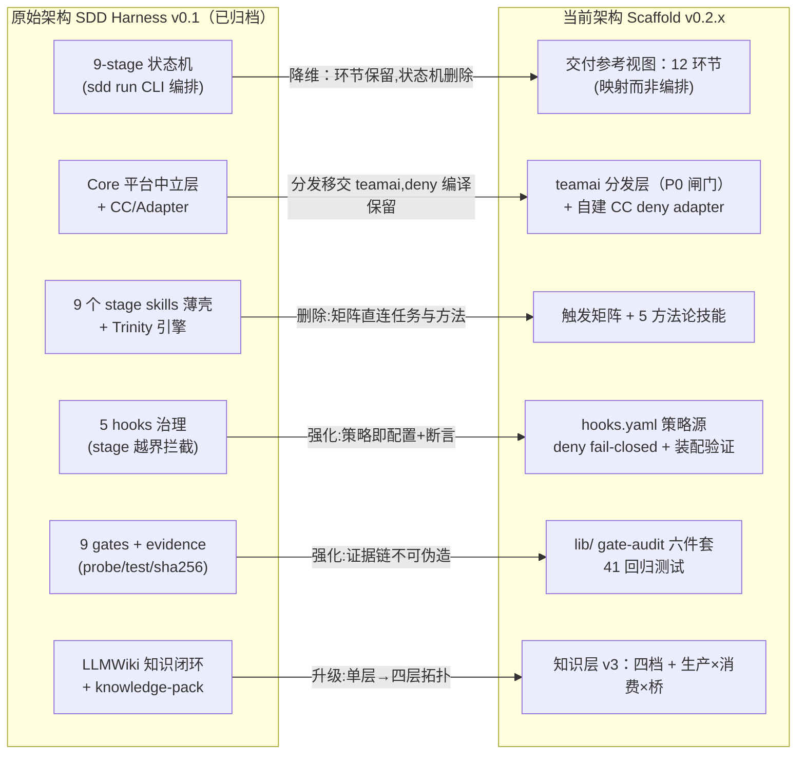
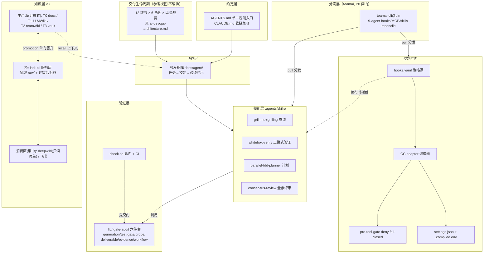
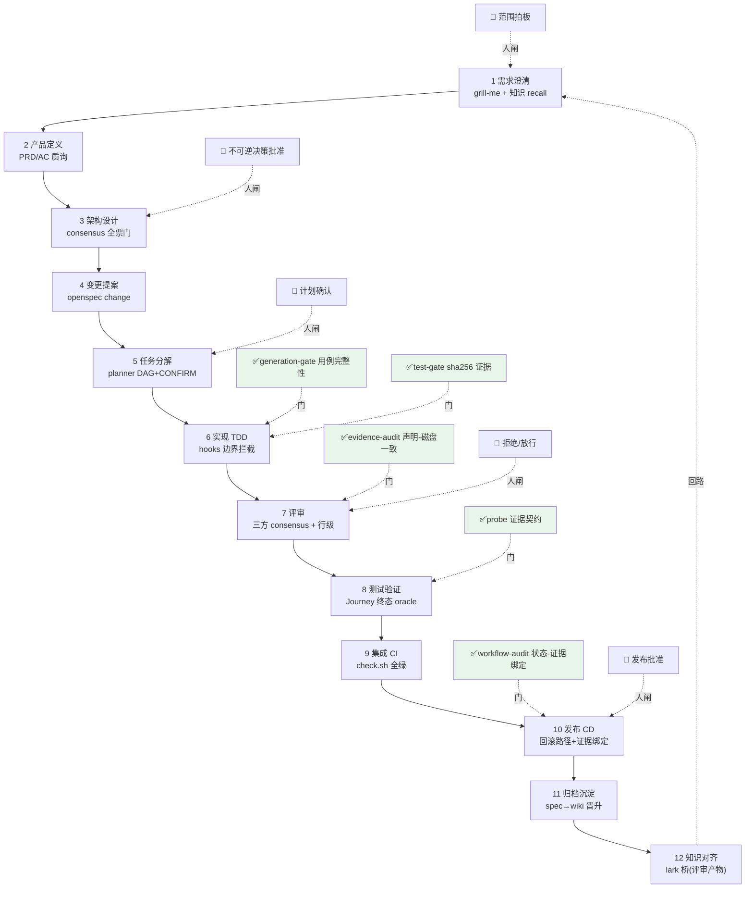
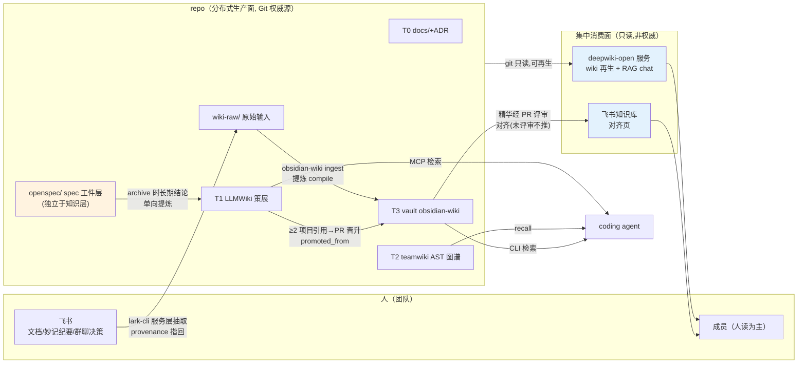
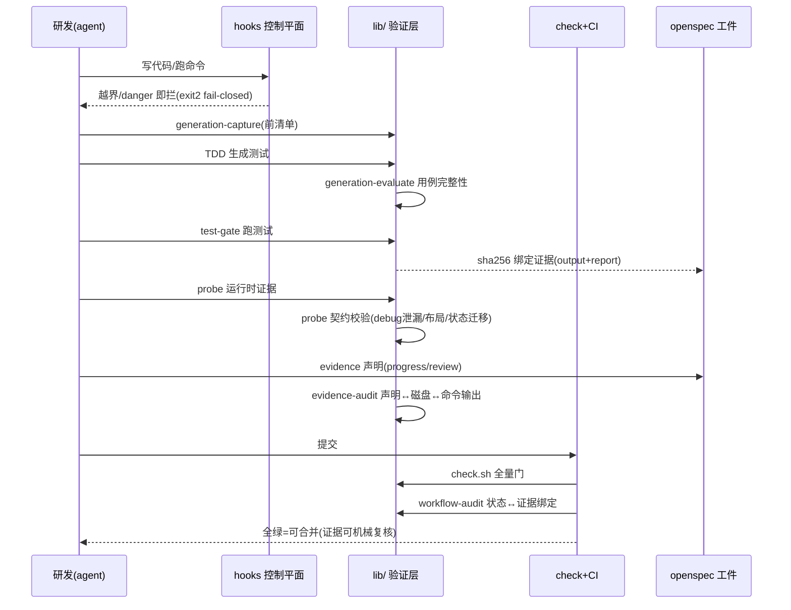

# 架构蓝图：原始架构对齐 + 全景图集

> 状态：权威。本文完成两件事：① grill 对齐原始 SDD Harness 架构与当前 Scaffold 架构（每个原始构件的去向与理由）；② 汇总全景架构图（mermaid）。
> 事实来源：[ADR-0008..0015](adr/)（原始决策链）、[scaffold-architecture.md](scaffold-architecture.md)（当前分层）、[ai-devops-architecture.md](ai-devops-architecture.md)（交付视图）、[knowledge-layer-plan.md](knowledge-layer-plan.md)（知识拓扑）。

## 1. Grill 对齐：原始架构 → 当前架构

原始架构（SDD Harness v0.1）= **9-stage 状态机 + Core/Adapter 分层 + 5 hooks 治理 + 9 gates 证据 + LLMWiki 知识闭环**。逐构件对齐：

| 原始构件 | 原始职责 | 去向 | 理由（grill 结论） |
|---------|---------|------|-------------------|
| 9-stage 状态机（`sdd run` CLI 编排） | grill→product→dev→test→code→review→verify→release→archive 线性推进 | **降维**：环节保留为 [AI DevOps 参考视图](ai-devops-architecture.md) 12 环节（映射而非编排，ADR-0015） | 工作流是流程意见不是设施；线性状态机强制所有变更走同一流程，与风险分级裁剪冲突。门禁保留为可组合的机械证据，顺序由团队按风险定 |
| Core 平台中立层 | CLI/状态/artifact 只依赖 Node+Git | **替换**：分发职责移交 teamai-cli（ADR-0018，9-agent 现成适配）；Core 的"最少依赖"原则保留（依赖仅 chalk/commander/fs-extra） | 自建 adapter 矩阵成本高；teamai 已是成熟实现。P0 组合幂等验证为闸门 |
| Adapter（CC reference + codex/opencode preview） | 各平台落地 commands/skills/hooks | **收缩再扩展**：自建 CC adapter（deny 编译器）保留 + teamai 承接多 agent 分发 | CC adapter 的 deny 语义编译（fail-closed/matcher 并集）是 teamai 没有的安全能力，保留；技能/MCP 分发是 teamai 强项，移交 |
| 9 个 stage skills 薄壳 | 各阶段触发 sdd-harness 公共 skill | **删除**：触发矩阵（任务类型→技能→产出）替代 | 薄壳=间接层无增量；矩阵直连任务与方法，维护面小 |
| Trinity 引擎（new/continue/apply/verify/archive） | OpenSpec 变更生命周期包装 | **删除**：直接用 OpenSpec 原生 opsx:* | 与上游重复；包装层漂移（曾发生 grill-with-docs 幽灵依赖） |
| workflow-frame.yaml / run 状态 | .sdd/runs/ 运行时状态 | **删除**：openspec/changes/ 工件 + lib audit 承载 | 双状态源易漂移；证据绑定（sha256）比自报状态可信 |
| 5 hooks 治理（stage 越界拦截等） | PreToolUse/SessionStart/Stop | **保留并强化**：hooks.yaml 单一策略源 + adapter 编译 + deny fail-closed + matcher 并集断言（共识评审 F-HOOKS-001 修复后） | 原方向正确；实现升级为策略即配置、装配级验证 |
| 9 gates + evidence（probe/test-output/sha256） | 阶段准入验证 | **保留并强化**：lib/ gate/audit 六件套 + 41 回归测试 | 机械证据是 AI DevOps 的信任根基（用户裁决：测试编写与验证必需） |
| knowledge-pack 组装 + sdd-context-mcp | 每阶段上下文包 | **删除**（stub 已清）；知识检索由知识层 v3 承接 | stub 依赖教训（诚实性原则）；recall（teamai）+ vault（obsidian-wiki）+ LLMWiki 分层覆盖 |
| LLMWiki 知识闭环 | raw→ingest→wiki + 沉淀 | **保留并升级**：成为知识层 v3 的 T1（策展层），闭环扩展为 生产面×消费面×桥（v3） | 方向正确但单层不够；v3 补分布式 vault/集中式 deepwiki/飞书桥 |
| understand-anything 代码图谱 | sdd graph 生成 knowledge-graph | **删除**（本地数据已清）；T2 由 teamwiki（AST 双轨）承接 | 单点工具+调度复杂；teamai import 内置且随分发层免费获得 |

**对齐结论**：原始架构的**三根支柱全部存活**——hooks 控制（强化）、gate 证据（强化）、LLMWiki 知识（升级为四层）；**被删除的都是编排与包装**（状态机、薄壳、Trinity、双状态源）。演化方向 = 从"规定怎么走"到"保证走得对"。

## 2. 全景架构图

### 2.1 演进映射图

### 2.2 目标架构总图（横切五层 + 两个引擎）

### 2.3 交付生命周期图（12 环节 + 门禁 + 人闸）

### 2.4 知识层拓扑图（v3）

### 2.5 证据链时序（一次变更的信任流）

## 3. 图集索引

| 图 | 用途 |
|----|------|
| 2.1 演进映射 | 对齐原始/当前，回答"为什么这样演化" |
| 2.2 目标总图 | 新人入门总览；分层 + 双引擎（分发/知识）关系 |
| 2.3 生命周期 | 团队裁剪流程的参照（门禁/人闸标注） |
| 2.4 知识拓扑 | 知识流向与权威源边界（写操作必经 PR/raw） |
| 2.5 证据时序 | 验证层如何构成不可伪造的信任链 |
