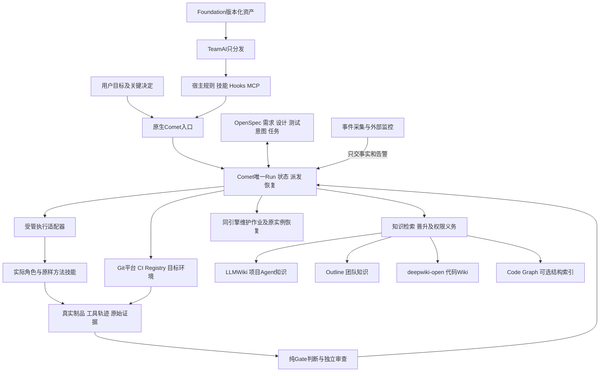

# AI DevOps流程与知识基础设施收敛架构

日期：2026-10-24。状态：执行目标已由用户明确要求，本文将既有决定收敛成实施契约；运行尚未验收。主检出基点`dcb9efa`，实施仍使用原OpenSpec Change和唯一DAG。

## 1. 回到最初的目标

最初目标是产品→架构→测试用例→Coding→独立验收→CI/CD，加上全过程知识检索与受控回流。Foundation供给CLI、方法技能、MCP和验证设施；Command约束真实工作，不能只提供阶段名称和提示文本。

原v3.1曾评估开发后端/外层控制器组合，随后用户明确收敛为Comet Classic唯一交付主控、TeamAI只分发；需求与架构分开、测试设计独立审查、目标确认后自动推进。知识选型也已调整为LLMWiki项目知识、Outline团队知识、自托管deepwiki-open代码Wiki，Code Graph独立且可选。不恢复旧Trinity/Superpowers九阶段引擎，也不把旧Git-vault/GBrain方案重新设为默认。

现在有可复用的门禁/状态/恢复代码和部分真实资源证据，但真实角色执行与知识触发没有接成一条链。偏差可由当前源码和产物确认，不能仅凭执行者名称或云端执行方式推断原因。

## 2. 清零的准确范围

| 清理对象 | 处理 | 保留与复用 |
| --- | --- | --- |
| 旧业务命令与别名 | 九个sdd-*命令、自动迁移source-command-sdd-*及受管链接退出发现链，不重定向成暗中兼容入口 | 保存内容摘要与可恢复备份；新会话不能发现或重新生成它们 |
| 旧流程依赖 | Trinity、Superpowers运行调用、sdd run阶段控制、旧workflow-frame权威、stage薄壳不进入新profile | 上游正文中的历史引用/许可证不篡改；只读历史审计不是可执行依赖 |
| 旧定义与文档入口 | 明确一套术语和当前入口；旧总纲/vault/双主控视图标历史，不再由默认规则引导执行 | 保留架构演进证据和有效ADR，不重写用户尚未提交的候选 |
| 技能发现与分发 | 只暴露当前profile选定的方法快照，安装器不能盲链所有目录 | 保留Matt、test-authoring、Whitebox等原样版本快照，按需显式升级 |
| 验收基线 | 新profile的accepted计数为0，所有required在新候选重新执行 | 原单测/负例仍作回归；原报告、原始日志、真实资源证据保留为历史，不自动继承PASS |
| 运行与知识数据 | 不因清理命名删除真实Run、知识、DB、证据或尚待恢复的工作区 | 旧Run保持版本绑定；迁移须围栏/重验，不能复制状态另开权威 |

本次已按用户指示把18个旧入口移到主检出`.local/retired-flow/2026-10-24-comet-reset/`，原始旅程证据另有17文件保留副本。还必须修复安装/发现/分发和新会话验证，不能把一次文件移动当作清理完成。

## 3. 目标架构与单一所有权

- **Comet唯一决定动作与推进。**保留原五phase及Run/锁/事务；本方案的逻辑动作不是新增一套阶段状态机。
- **执行适配器只执行。**领取准确工作包、调用实际Agent/工具、返回真实结果；不保存第二currentPhase、业务重试或DAG。
- **方法技能不当主控。**P动作只消费planner的计划产物与验证方法，工具权限中没有派发/Goal/监督/归档；完整planner控制器只用于本次迁移实施，不嵌入产品Run。
- **Gate只判断。**Comet接纳受信结果；它不得接受作者自填身份/pass或被改绑的旧共识票。
- **基础层继续可复用。**可选受管profile承担该流程，不要求普通查询/翻译等任务经过研发全链路。
- **先CLI+固定Runner。**后台持续运行可以由受管执行驱动/原实例监督支撑，不为7300健康页先造常驻业务Server；若实证需要扩展Comet服务模式，必须在同引擎内说明原因、认证和恢复语义。跨机器Control API仍按单独范围决定。

## 4. 命令、动作、技能与制品必须逐条绑定

对用户的业务入口统一到原生`/comet`，现有CLI用于机器驱动和诊断；不创造另一套/sdd:*阶段入口。以下动作名是合同概念，不冒充已存在的shell命令。每项绑定必须由实现和真实调用验证，不能只写在表里。

| Comet位置/动作 | 实际方法/执行角色 | 正式输出 | Gate与失败路由 |
| --- | --- | --- | --- |
| Open/R | grill-me；需求作者/有权需求确认者；按权限检索知识 | OpenSpec目标、范围、AC、非目标、环境与需求revision | 关键问题未闭合不能进入正式架构；业务范围问题回owner |
| Design/A | 架构作者、grill-me、独立共识审查 | design/ADR、当前制品冻结包、原始票/manifest/tally | 参与者/阈值来自受保护policy，原摘要不可改绑；拒绝回架构作者 |
| Design/T | test-authoring设计；独立测试设计审查者 | TestPack设计态、case/oracle/覆盖、执行环境与数据清理 | 不以结构有效代替充分性；弱oracle/覆盖缺口回测试作者 |
| Build/P | 只做计划的planner方法 | 同Change的唯一tasks/DAG、允许路径、case引用 | 不派发、不启动第二Goal/监督/归档；计划问题回计划作者 |
| Build/测试与实现 | test-authoring自动化、Builder的Matt tdd、code-review | 实际行为RED/GREEN、代码/测试候选、独立代码审查 | 环境失败不算RED；测试问题回作者、产品问题回Builder |
| Verify/V | whitebox-verify独立验收 | 原始typed ledger、validator结果、数据/截图/网络/日志与终态读回 | 未执行/缺能力/新候选/弱测试不放行；验收者不修产品后自评 |
| 集成/发布义务 | 既有平台CI/CD执行者 | 精确集成SHA、required checks、构建digest、目标环境及回滚读回 | 流水线绿不等于部署完成；无授权不发起外部写 |
| Archive/Kp | 知识作者、独立审查、项目知识写入身份 | LLMWiki精华条目、索引/引用与版本独立读回 | 必需项目知识未闭合，所有真实归档入口都拒绝 |
| Archive/规格 | Comet唯一Spec Adapter | OpenSpec真实归档、主规格与场景集合读回 | 中断先调和原归档操作，不重复sync/archive |
| Archive/Kt | 受管Publisher、授权判断与独立读回 | Outline团队条目、原operation/目标UUID/版本/受众 | 可先归档后发布；未知结果先读回，同Run恢复，Kt缺失不能completed |
| 完成后维护 | 只交事实的采集器→同Comet引擎→Isolator | 关联原Run/知识的维护作业、真实隔离与新授权恢复 | 事件+周期全量核验；重试/补偿归Comet，监控只报警 |

角色职责和容器数量不硬等同。Verifier必须与Builder/测试作者是独立受信执行；三方共识也必须是实际独立执行。不能用同进程中的三个名字制造独立性。

## 5. 两类知识库与代码知识的边界

| 存储 | 权威内容 | 明确不承接 |
| --- | --- | --- |
| OpenSpec/Git正式工件 | 本次变更的需求、设计、测试意图、任务、决策与版本 | 不把LLMWiki检索结果当作已批准需求，不将同一规范复制成多个权威 |
| LLMWiki | 单项目Agent可复用的精华：已验证经验、约定、失败教训、知识引用/索引 | 不存整仓源码，不作为团队ACL平台，不承担变更状态 |
| Outline | 审核发布的团队知识财富、跨项目经验、受控文集/成员访问 | 不批量摄入全部代码/所有聊天，不以服务账号可读代替披露授权 |
| deepwiki-open | 固定repo/commit的代码解释与查询 | 不作为团队经验库，也不签正式架构/需求批准 |
| Code Graph | 可再生的结构、依赖、影响面事实 | 不编造业务结论；可不启用，禁用后仍须正确 |

Git是规范/允许版本化工件的权威，Outline是其受控知识正文及访问状态的权威；不沿用旧方案“所有团队知识真身必须进Git”。敏感原件/凭据不进入公共仓库。跨项目发布必须核对所有实际输入源的披露交集、目标完整受众及当前grant。

### 知识流程触发与硬门

| 时点 | 自动动作 | 必须验证 |
| --- | --- | --- |
| R/A开始前 | 按项目与身份检索LLMWiki/Outline；架构按需查询代码Wiki/图谱 | source/revision/权限/适用范围，检索结果只作上下文 |
| 架构或测试设计通过 | 形成候选知识摘要/引用；正式制品仍归OpenSpec | 不自动把草案变成团队知识，不复制整个设计 |
| 缺陷修复、独立V通过 | 根据实际问题与修复证据提炼精华 | 知识作者/审查独立，引用当前版本，不能凭成功自述沉淀 |
| 请求归档 | 执行冻结policy要求的Kp更新与独立读回 | 失败硬阻断归档；无知识增量必须按预先policy独立判定，不能失败后改豁免 |
| 规格归档后 | 当前预授权内独立审查通过则自动发布Outline | 越范围/敏感内容回有权owner；Kt未闭合Run仍pending |
| 需求/设计/源码/权限变化 | 重新计算适用性及知识义务 | 新revision不复活旧票；内容过期与发布期限分别处理 |
| 源撤权/受众扩大/grant撤销或到期 | 事件或周期全量核验交给同Comet维护 | 实际Web/分享/搜索/附件/MCP不可访问，恢复须新授权；正常3分钟发现+2分钟隔离与故障暴露分开计时 |

## 6. 信任与恢复不能留在提示词

每个工作包至少绑定实际Run/action/task/gate、受信执行身份、允许路径/工具、输入/策略/方法快照摘要、attempt/epoch/revision及原始证据引用。身份来自受保护启动记录和结果通道，不来自结果JSON的role字段。Skill文件被读取也不单独证明方法正确应用，仍需产物、动作轨迹和独立语义审查。

A使用当前制品的原始manifest/票/tally；不能把旧计划票的artifactDigest改成新设计digest。T必须评估实际case与oracle；V必须走真实业务断言，print-ok/预写正确候选不是TDD或独立验收。

需求/设计变化保守失效所有下游；恢复旧字节不复活批准。历史事务恢复与批准新动作分开，复用原Run/锁/journal。真实Comet故障应在提交前后和远端未知结果窗口注入，保持原authority/Run/operation，不能用计数worker替代。

I08必须摄入真实Comet的目录/字段及Kp/Kt/publish义务，贯通知识DB和附件一致恢复。未完成唯一工作区不能按年龄清理。监控在Runner故障域外，告警发送有独立授权；进程监督仅重启原实例。

## 7. 后续实施顺序与原任务

1. **S0 固定目标与证据。**P0_1–P0_4：收敛文档/术语/角色/源；保存旧验收，新的Comet profile验收计数归零。原39节点/69工作包/92场景保留；新增12个贯通场景补充用户要求，统一一份DAG。
2. **S1 清理并防再生。**P1_6/P1_2：可恢复退出旧入口/链接/别名，修发现器、安装器、TeamAI分发与受管块，保持用户配置和deny语义。全新会话不得发现旧路线。
3. **S2 资格化基础设施。**P1_1/I01–I06：固定工具链和完整Comet发行；真实验证两类知识库、代码Wiki、平台、凭据引用与角色隔离。CodeGraph可选；不把所有MCP都建成服务。
4. **S3 接通实际动作。**P1_3/P1_4/P1_5/P2_1–P2_5：profile的数据绑定接到原Comet，真实Runner调用角色/技能，结果接纳与返工共用判定。接口数据不成为第二流程引擎。
5. **S4 先跑真实R→V切片。**P3_1/P3_2/P3_3：先资格化验收器，再检验真实方法调用、冻结制品、RED/GREEN与独立Whitebox，实际中断后恢复。禁止用完整下游旅程PASS作为建设前置形成循环。
6. **S5 接通平台与Kp/归档/Kt。**P3_4/P4_1/P4_2/P4_4/P4_5/P4_6/P4_7：真实平台SHA/digest与部署终态、LLMWiki项目知识、唯一规格归档、Outline自动发布与同Run未知结果恢复。
7. **S6 持续治理与恢复。**P4_8/I07/I08/P5_1/P5_3：真实事件+周期核验、受众与权限维护、外部告警、实际状态形状备份/恢复/R10。P5_2/F10维持独立范围决定，不以未启用测试代替能力认证。
8. **S7 新基线整体验收。**P4_3/VERIFY：所有原场景与新增12场景，在同一最终候选、全新宿主会话和真实Run重验；完整角色链、平台、两类知识、权限维护与原生恢复都闭合后才完成。随后由Comet做本迁移Change的规格归档/后审。

各阶段可以先建设工件和做声明范围的局部资格，完整旅程只在VERIFY、所有依赖就绪后执行。局部接纳不关闭跨边界要求。编码默认Matt TDD；测试作者、Builder和独立验收分工保持。只有明确业务/安全授权或不可恢复阻塞交人，命名、路径、版本隔离和陈旧断言属于工程修复。

## 8. 从原目标到当前的Gap判断

| 原目标 | 当前已有 | 仍缺 | 差距性质 |
| --- | --- | --- | --- |
| Foundation可靠分发 | 技能快照、导出锁、adapter、部分组合测试 | 旧入口退发现后的防再生、干净安装、统一profile与原生注册 | 集成缺口 |
| Command端到端控制 | next/dispatch/accept/transition及硬门代码 | 实际角色/方法/制品/可信回执连接与自动推进 | 主执行链断口 |
| 两类知识贯穿 | LLMWiki工具、Outline真实API证据、权限判断模块 | 检索触发、精华提炼、Kp/Kt独立硬门及持续维护接线 | 知识闭环断口 |
| 架构/测试/验收独立 | 部分机械约束、单调失效、部分真故障记录 | 原制品真实审查、实际TDD和Whitebox终态，禁止旧票改绑 | 验收可信度缺口 |
| CI/CD交付 | 检查器/本地机制与候选契约 | 真实平台阻断、同digest部署/回滚与目标读回 | 环境+端到端集成缺口 |
| 持续运维 | 部分fencing/恢复/计时函数和探针 | 原生状态适配、知识DB/附件恢复、外部监控和实际告警 | 运维闭环缺口 |
| 可交付完成判定 | 结果文件明确目标未完成 | required全通过、唯一状态一致、原始证据可持久交接 | 交付门尚未关闭 |

不能给出无依据的完成百分比。可复用底座不少，关键差距集中在主执行链、知识闭环和独立验收，而非若干命名/凭据小修。

## 9. 验收与执行边界

所有旧结果归历史支持证据，新的profile没有继承通过数。旧118检查保留并修正错误oracle/失配命令；新增12个命令与知识贯通检查，基线共130检查/104场景。fixture保留为机制回归，真实旅程中禁止假审查、伪MCP、假archive、目录形态Registry替代要求真实平台的终态。

计划/Goal/20分钟监督由唯一迁移控制器维护，真实执行后绑定实际进程和宿主。产品流程的P动作不能再启动这些控制器能力。终态要求全required、独立Whitebox与证据Grill、实际知识与平台义务完成；F10/授权/真实资源缺口不自动变PASS或被统计豁免。新profile的框架发布评估与每次业务Run的放行是两种门，互不替代。

本文未宣称新profile已实现。现场清理和P1_2防再生修复已开始；其余按同一DAG逐项执行，不批准全局删技能、清空知识或销毁旧工作树。
