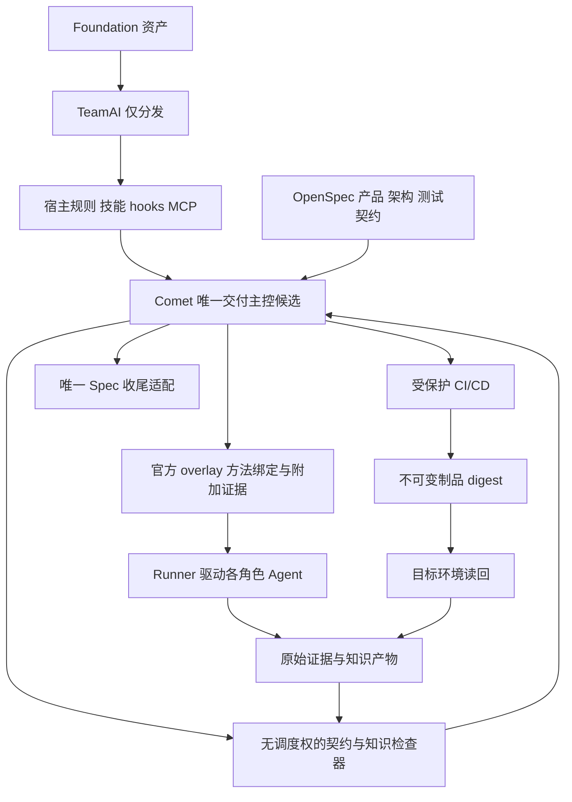

# SDD Harness 交付架构

> 状态：原架构基线评审已通过，运行尚未验收；2026-10-20 官方 overlay 优先及 Ponytail 补充已据预研形成重规划候选，待 OVR 独立评审。原评审回执仅对应原冻结制品。
> 决策入口：[ADR-0019](adr/0019-delivery-foundation.md)。实施与验收唯一清单：[OpenSpec 变更](../../openspec/changes/delivery-foundation-rearchitecture/tasks.md)。
> 现有运行基线：`c42d3ce0360a66dbc14e299f33811ab94b392a68`，`ai-coding-scaffold@0.2.4`。旧 scaffold 继续可用；本文不将目标能力标记为 ready。

> 最新范围决定：用户已确认目标后默认自动推进，人只处理关键决策与阻塞；TeamAI 首期只分发。Comet 作为唯一交付主控候选，不再采用 TeamAI 外层 workflow。Comet 能否覆盖全部硬门禁仍待适配与实证，详见 [单主控审视](../../openspec/changes/delivery-foundation-rearchitecture/comet-single-controller-review.md)。

## 1. 目标和方案选择

覆盖产品 → 架构 → 测试用例 → Coding → 测试验证 → CI/CD。保留 scaffold 的规则、技能、hooks、MCP、OpenSpec 和 gate/audit，在显式启用的 delivery profile 中补充可验证交付。一个 Change 贯穿所有制品，交付是否完成取决于事前约定的目标环境和独立业务读回。

| 方案 | 收益 | 代价 | 选择 |
| --- | --- | --- | --- |
| 继续叠加 skills/hooks | 迁移小 | 方法技能继续承担状态、调度、收尾，恢复与信任问题未解决 | 排除 |
| 直接使用原版 Comet | 状态/检查/恢复复用多 | 尚未证明全部测试、知识及发布义务不可绕过 | 不能直接验收为满足 |
| Foundation 分发 + 单一交付主控 + 检查器 | 保留积累，避免重复调度 | Comet 候选需满足 OpenSpec、验证与知识硬门禁 | 当前验证方向 |

以本轮用户决策为准：TeamAI 只分发，Comet Classic 是当前唯一交付主控接入路径。固定工程过程与 OpenSpec 权威是选择 Classic 的依据；Native 仅作能力对照，不将其 Supervisor/独立验收协议计作 Classic 现成能力。方法层优先复用官方 comet-five-phase-overlay、来源解析、原生 handoff/canonical plan 和平台编译；共同判定、可信回执及收尾的实际缺口才做最小 Runtime 扩展。隔离预研与任务增量见 [overlay 接入设计](../../openspec/changes/delivery-foundation-rearchitecture/overlay-integration-design.md)。

## 2. 分层和唯一所有权



| 对象 | 唯一写者/事实源 | 禁止的重复职责 |
| --- | --- | --- |
| 需求、设计、用例、策略 | 审查后的 Git 基线 | Agent 自行降低必验项 |
| 团队资产 | `.agents/skills/`、`hooks.yaml`、`mcp-capabilities.yaml` | 分发目录手改成为第二源 |
| 交付步骤、开发子图、worktree、候选、attempt 与恢复 | Comet 单一 Runtime（完整覆盖待验证） | TeamAI、Gate、技能不得再保存/推进同一任务阶段 |
| 证据准入、审批、GateReceipt | SDD Gate；团队模式为 Control API | 方法技能自签可信 pass |
| 原始执行结果 | 登记 Runner/观察器 | 摘要或结构校验代替真实执行 |
| 合并、构建、部署 | Git 平台、Registry、CI/CD | workflow success 代替发布事实 |
| 规格归档与读回 | Spec Adapter 独占该 Change closeout | Planner 和 Comet 同时归档 |

本机原生配置每个受管块仅一个 reconciler。兼容验证前继续使用现有 CC adapter；验证通过后才逐块移交 TeamAI。deny 策略编译仍来自根 hooks.yaml，分发器只落地注册。Comet Guard 必须通过实证支持的入口组合，不能直接叠加两个阶段 Guard。

overlay 从原 Classic 状态推导节点，不独立 init 或推进 phase，其 sidecar 不作任务进度/批准/可信身份源。control 节点保持原实现，design/plan producer 替换满足原 schema；Ponytail advisory、Matt 方法、测试作者和 Whitebox 按职责绑定。Required Skill 标记及字段存在性不是可信调用/业务结果证明，仍由 Gate/Runtime 核验真实来源。

## 3. 六环节契约与失败返回

| 环节 | 输入 | 输出与通过条件 | 失败返回 |
| --- | --- | --- | --- |
| 需求澄清（产品） | 问题、事实、范围、交付环境 | ProductBaseline：稳定 AC、终态 oracle、owner、非目标 | 范围决策者 |
| 架构 | 产品与源码基线 | DesignBaseline：接口/数据所有权、风险、迁移/回滚、ADR | 产品/架构 |
| 测试用例 | 产品和设计 | TestContract：AC→case、oracle、数据、环境、清理、真实/替身依赖、覆盖分母 | 测试作者 |
| Coding | 三基线、PlanBundle、允许路径 | 行为 RED→GREEN、实现和测试、冻结候选 | Builder；契约变化回上游 |
| 测试验证 | 冻结候选、测试集、环境、权限 | 独立评审与真实执行；必验项全部有效，缺口为零 | 产品缺陷回 Builder，弱测试回作者，工具缺口回环境适配 |
| CI/CD | 精确集成候选、有效 GateReceipt | required checks、构建 digest、同 digest 提升、部署后独立读回 | 重验、恢复或已批准回滚 |

需求澄清与架构是两个独立逻辑环节、两份版本化基线和两个前置门禁，不合并为“目标确认”。需求澄清回答用户/业务问题、期望行为、范围、约束、AC/非目标和交付环境；不得由技术方案替代需求。需求门核对可观察目标、验收完整性和未决业务问题后，架构才消费该基线。架构回答模块、接口、数据所有权、实现约束、技术取舍、迁移/回滚和验证可行性，必要决定写 ADR；架构门核对每项 AC 的设计归属、边界风险和测试可行性后，才进入测试设计和实施计划。

架构发现成本/兼容/风险或可行性冲突时，向需求环节提出范围/AC 变更请求；需求 owner 确认后形成新 revision，并重算设计及下游证据，不静默修改已确认目标。已有有效需求或设计可分别复用并核验适用性。两个环节不要求两个常驻 Agent，也不意味着两个调度器；均归 Comet 单主控。门禁通过默认自动推进，只有尚未授权的业务/风险取舍才询问人，不把每个门禁变成人工审批。

测试设计 T 是不可跳过的前置门禁；风险仅调整深度，不能把它降为材料完整性检查。必须核对 AC/case 覆盖、独立 oracle、真实可观察终态、环境/数据可行性、关键负向场景与冻结版本。建议采用独立只读自动审查，正常通过自动继续。T（设计充分性）、Build 测试质量（缺陷敏感度）、V（产品独立验收）分别成立，互不替代。

测试意图先冻结，测试代码可在 Coding 切片中迭代。测试作者自检不能签发独立验收。Whitebox 只读候选，可写观察脚本与隔离测试数据；修复产品或测试必须创建新版本后重验。

Planner 只生成计划、DAG、范围和验收引用；不派发、不启动监控、不持有运行状态、不 archive。test-authoring 负责用例与测试代码/fixtures/质量自检。Whitebox 负责独立验收和缺口。现有 vendored 技能保持原样；这些是目标调用边界，迁移需显式升级、负例回归和版本兼容验证，不能靠新增提示隐藏旧 controller。

七角色沿用 PRD、架构、测试作者、Builder、Reviewer、Verifier、CI/CD；角色不是七台服务，也不要求七个常驻会话。

## 4. 共享契约和信任

以下是拟议接口，不是当前 CLI 或上游已提供的格式：

| 契约 | 必需内容 |
| --- | --- |
| FoundationLock | 资产发布 commit、导出摘要、技能摘要、schema/policy、CLI/Runner 版本与平台、profile |
| BaselineRef | project/change、制品 kind、revision、digest、确认主体与确认范围 |
| TestContract | AC/case ID、oracle、必验层级和能力、执行分母、环境/数据清理、依赖基线 |
| PlanBundle | 任务依赖、单一 scheduler owner、允许路径、worktree、验收引用 |
| CandidateRef | project/change/run/attempt、backend candidate、完整输入摘要、builder execution |
| EvidenceEnvelope | candidate、case/check、origin/execution、环境/工具链、执行数、结果、原始证据 URI/digest、期限 |
| GateReceipt | policy/schema、输入摘要、证据集合、必验分母、阻断原因、来源认证 |
| ReleaseReceipt | integration SHA、build digest、目标环境、配置/迁移版本、部署/回滚身份、独立读回 |

代码、测试、锁文件、迁移、部署配置都纳入摘要；不能继续只对 src/ 的 JS/TS 做完整性承诺。追踪为 AC→设计→case→执行证据→候选→构建 digest→环境回执。任一基线、oracle、工具链、policy、环境或集成候选变化，默认使依赖回执失效，保留原记录和原因。

digest 证明内容绑定，不证明来源可信。schema PASS 仅证明结构；Runner 身份与派发记录决定可信来源。Verifier 必须与 Builder 为不同执行身份，且来源经过登记；调用者自填角色无效。同 OS 账户可随意改账本的本机模式只承诺协作检查，不能声称防篡改。发布凭证与可信策略只存在受保护 CI/服务端。

必验项不得因 skip、零测试、全部跳过、缺 console/network/trace、服务未启动而假绿。DOM/截图、网络、console、服务日志分别标记，不能互相冒充。能力不满足时 blocked/UNVERIFIED；不适用性必须在执行前确认。

## 5. 状态、恢复和规格收尾

交付执行阶段与允许动作归 Comet；Gate 只存判定与依据，不建立平行执行阶段。命令必须关联 project/change/workspace/run、command_id、expected_revision、attempt 和输入摘要；幂等和旧版本拒绝由实际拥有该状态的后端执行。禁止通用 set-status=passed 接口。

跨后端操作采用记录意图→关联 ID 派发→查询外部结果→写绑定回执。重启先 reconcile；不能因缺回执再次部署或重复开子任务。租约 epoch 是 fencing 依据，心跳 TTL 不是完成证明。Comet 所选模式是否满足所需语义必须先测；不能凭本设计假定已支持远程 fencing。

团队级远程调度不在首期承诺中；本地 workflow 数据目录不能共享挂载后充当分布式调度。命令结束不等于后台进程持续运行，持续执行需受管进程/CI。

工程验收、规格收尾和发布独立记录。Spec Adapter 保留场景映射、源冻结、MODIFIED 全场景保留、合并预演、主规格并发摘要检查、archive 后读回与中断恢复。Comet 内部 Archive 与团队 OpenSpec closeout 必须配置唯一 owner；若无法禁用/隔离双写，试点 NO-GO。

closeout 策略明确 in-change 或 after-merge。archive 已包含 sync 时不重复同步。不可将 closeout checkbox 混入实现验收分母造成循环；归档成功也不代表目标环境已交付。

## 6. Foundation 与部署

必需基础能力为 Git、共同兼容且固定版本的 Node、校验器所需 Python、至少一个已验证宿主、OpenSpec、SDD CLI；TeamAI 和 Comet 在对应 profile 验证后启用。语言工具链、Docker、平台 CLI 按项目选择，CodeGraph/RTK 为可停用优化。

基础技能围绕澄清、架构审查、计划、测试编写、验收；高风险按条件加载边界/共识审查。现有 .agents/skills/ 是真实目录源；不批量搬迁，也不重新引入所有 Superpowers 作为强制依赖（ADR-0016 保留）。

MCP 使用原生工具优先，stdio 按需启动。浏览器按当前 harness 发现交互、截图、console/network/trace；不要求中央浏览器池。保留现有 mcp-capabilities.yaml 三态，不把注册当作真实可用。

TeamAI 发布视图拟由 exporter 生成 skills/、hooks/hooks.yaml、mcp/mcp.yaml；它们是产物，不能与源双向编辑。FoundationLock 在一次 run 内固定完整资产；单个流程或 prompt 的冻结不自动覆盖技能、hooks 和工具链。新 pull 不得静默改变旧任务门禁；无法保持旧基线则暂停并显式迁移重验。

| 模式 | 新增服务 | 承诺与限制 |
| --- | --- | --- |
| 单机/单 CI 试点 | 0 个常驻业务 Server；Gate/Spec CLI | 一个受管环境的真实闭环，不承诺跨机器租约/永续后台 |
| 团队跨机器 | 1 个 Delivery Control API，复用 PostgreSQL/证据存储/身份服务 | API 管审批、证据、回执与审计；调度仍归经验证后端 |

复用 Git、CI Runner、Registry、CI artifact/对象存储、Secrets/OIDC 和隔离验证环境。首期不新增 Redis、MQ、向量库或模型网关。API 不可用必须阻断发布；不能读取缓存绿灯。多项目隔离、凭证撤销和备份恢复是团队模式准入条件。

### 6.1 知识栈职责（Grill 收敛）

首期采用 LLMWiki（Agent 本地单项目知识）+ Outline（团队精华知识库）+ DeepWiki（代码 Wiki）。GBrain 不纳入首期。Code Graph 管源码结构索引；docs/ADR 保持项目设计权威，不能全量灌入知识库或由派生解释替代。

Agent 通过各自 MCP/CLI 入口访问，先不建中心网关。Outline 使用官方 MCP；LLMWiki 沿用本地 stdio；代码 Wiki 已明确选择自托管 deepwiki-open；其固定发行版本、实际 API/MCP 和权限仍须实测，不能套用 Devin 公共 DeepWiki MCP。配置可分发，认证按成员/服务身份独立授权。

MCP 只解决工具访问，关联靠稳定资源 ID、来源 URL、项目/代码 revision、权限与生命周期。LLMWiki 的项目经验提炼后经审核/跨项目授权才晋升 Outline；正式团队条目在 Outline 唯一维护，本地保留引用，不双向复制整库。具体准入 owner 尚待 Grill。

服务端是团队 Outline 和按需自托管代码 Wiki；本地是 Agent/LLMWiki/工作区图谱，代码索引生成也可运行于 CI。服务选定不代表已部署。知识服务与交付 Gate 的事实源保持分离。

### 6.2 OpenSpec 与 LLMWiki 的关系

OpenSpec 是规范与变更权威：openspec/changes/ 管本次提案、delta、设计、任务；openspec/specs/ 管持续有效的已接受行为。它不是只在任务期间存在的临时材料。

LLMWiki 是项目经验与理解层：保存问题排查、试验结果、概念解释、经验草稿及原始证据引用；条目区分已验证/待验证/已失效，不能覆盖或替代 OpenSpec 的验收要求、任务状态和 GateReceipt。架构决策仍以 Git docs/ADR 为准。

实施前，Agent 检索 LLMWiki/Outline 为提案提供证据；要改变规则，仍走 OpenSpec/ADR 的显式审查。实施中可沉淀失败试验与经验，但不能把草稿当成已接受行为。验收后选择性提炼知识，携带 Change/scenario、commit、证据引用；archive 不触发无差别全文复制。旧知识与新 spec 冲突时按当前规范执行并标记知识待更新，不能自动反写规范。

项目经验经审查与权限批准后可晋升 Outline。知识服务不可用不妨碍读取 Git 规范；知识页存在或 ingest 成功不能充当实现/验收/归档通过证据。

Outline 许可说明：本轮核对 main LICENSE，当前标注 BSL 1.1（版本 1.11.0），属于源码可用、有使用限制的许可，不应称为当下 OSI 开源。团队内部部署与对外提供商业 Document Service 的授权边界不同；正式选用须固定所用版本并核对该版 LICENSE 和所需社区/商业版功能。此次不改变技术选型为已上线状态。

### 6.3 Agent 流程与知识边界协议（目标设计，尚未接线）

#### 路由规则

1. 会约束交付的范围、行为、设计、接口、测试 oracle、任务或风险决策，必须进入当前 OpenSpec Change；持续有效的行为经规范收尾进入主 specs。持久架构决定归 docs/ADR，并由 Change 引用。
2. 可复用的理解、失败试验、排障方法和解释进入 LLMWiki，附来源与验证状态。它不保存权威任务状态、验收分母、审批或运行账本。
3. 支撑本次阻断/设计决策的探索发现必须在 Change findings 中形成可评审的事实记录，即使详细探索笔记保存在 LLMWiki；后续执行不能依赖不断变化的知识页才能理解义务。
4. 原始测试/运行日志、截图、trace 和环境读回保存在证据存储；Change 记录检查结论与不可变证据引用，LLMWiki 仅提炼经验。wiki 页面不能成为执行证明。
5. 未形成变更意图的一般研究不必建立 Change；一旦准备修改行为、接口、交付契约或不可逆架构，先按仓库规则建立提案，不允许从 wiki 笔记直接授权实现。

#### 按环节的读写矩阵

| 环节/角色 | 必须读取 | OpenSpec/Git 主产物 | LLMWiki 产物 | 交接条件 |
| --- | --- | --- | --- | --- |
| 需求澄清 | 用户目标、既有主 specs；按需检索知识 | proposal、delta specs、AC 与未决范围；产品确认依据 | 术语/领域解释草稿，可选 | 关键范围与 AC 可观察；知识建议被审查后才成为规范 |
| 架构设计 | 产品基线、实际源码/Code Graph、docs/ADR；按需 DeepWiki/知识 | design、契约、风险/回滚；必要 ADR；决策 findings | 备选方案试验和方法，标记未采纳/已验证 | 设计与 AC 对齐，选定输入版本；不以代码 Wiki 替代设计审查 |
| 测试设计 | 已确认 AC/设计/接口 | AC→case 追踪、测试意图、oracle、必验层级和环境引用；测试代码在源码测试目录 | 可复用边界值/测试方法，不能改验收分母 | 明确每个 AC 如何验；作者自检不等于产品验收 |
| 计划 | 上述已确认输入与资源边界 | tasks、开发子图、允许路径与验收引用 | 无强制写入 | 计划有效并交运行后端；planner 不派发或监督 |
| Coding | 当前任务及冻结输入，必要知识引用 | 实现/测试在 worktree；Change 记录任务证据引用和契约偏离 findings | 失败尝试、解释、项目经验草稿 | 候选、测试集和输入摘要冻结；不能自行降规范 |
| 独立验证/评审 | 当前候选、冻结 TestContract、真实环境 | findings、逐 AC 结论与回执引用；原始证据不重复搬进 wiki | 可选验证方法经验，不承担放行 | 缺陷回 Builder、测试缺口回作者、需求冲突回上游、环境问题回适配器 |
| 集成/发布 | 有效候选回执、精确集成 SHA、发布策略 | Change 记录平台检查/产物/部署回执引用；平台持有真实状态 | 可选运维经验 | 按目标环境判定；工程归档、合并、部署分别记录 |
| Spec 收尾 | 规格预演、任务证据、主 specs 当前摘要 | 唯一 Spec Adapter 执行 archive/主 specs 同步和读回，遵循 in-change/after-merge 策略 | 不自动全文复制；可排队选择性提炼 | 无旧场景丢失、无并发漂移、部分失败可恢复 |
| 知识沉淀 | 已验证结果、决策、有效证据 | 若发现新规范需求，另建/修订 Change；不能反写已接受 spec | 可重用项目知识；经审查授权再晋升 Outline | 与功能交付分开统计，不因缺知识页无限等待交付 |

同一条研究可同时有“当前 Change 必需的事实记录”和“面向未来的经验提炼”，但只有前者决定当前交付。两者引用同一原证据，不维护两套要求或完成状态。

#### 单一协调者与显式交接

Comet 单一主控决定下一个允许执行的角色；Gate 检查契约/证据，不拥有派发权。方法技能不互相隐式启动其他 controller。LLMWiki/Outline 不派发任务，OpenSpec CLI 的材料完整状态不证明实现完成。

每次交接绑定 project/change/task、run/attempt、输入制品 revision/digest、必要且有权读取的知识引用、允许修改范围、AC/case 分母、预期回执类型。接收者核对版本和权限后开始执行；不允许“上一个 Agent 已经理解”式隐式传递。知识引用若影响正确性，相关结论须先纳入冻结设计/契约。

调用形态：OpenSpec 通过原生 CLI/文件操作；LLMWiki 与 Outline 通过各自 MCP；DeepWiki/Code Graph 通过认证后的工具入口；运行后端统一收结果。不能因为都有 MCP 就要求服务互相调用或复制全部内容。

任务有四种不同状态，各有唯一 owner：OpenSpec tasks 表达实施清单完成情况并附证据；运行后端持有 queued/running/retry 等执行事实；Gate 持有候选放行回执；知识条目持有 draft/validated/stale 等知识状态。协调者关联它们，不提供可随意同步的统一 passed 字段。

#### 失败与改动路由

- 实现不满足既定 AC：验证记录阻断，回 Builder；可另记 wiki 经验，但经验写入不能解除阻断。
- 测试覆盖/断言不足：回测试作者；如改变冻结 oracle，重新审查并失效旧回执。
- 发现需求/架构有误：回 OpenSpec/ADR 修订路径，生成新 revision；不能仅改 wiki 绕过批准。
- 环境故障：保留失败类别并修复环境；不得计为有效行为 RED。
- wiki 与规范冲突：按适用的已接受规范执行，标记 wiki 待修订；若规范确实错误，仍经显式变更流程。
- 发现可复用经验但不影响当前正确性：进入知识沉淀队列，不强制回退开发环节。

#### 例子

本次需求“导出仅含当前租户的数据”进入 delta spec/AC；跨租户负向用例和 CSV 读回 oracle 进入 TestContract；Builder 在源码实现过滤条件；Verifier 记录请求和文件内容的独立读回。运行后端处理失败重试，Gate 判定当前候选。验收后“异步导出必须把租户身份绑定在任务上下文，不能依赖触发请求的线程状态”可成为 LLMWiki 项目经验；领域 owner 的准入职责待确定后，经审核/权限批准进入 Outline。整套源码和验收材料不复制进知识库。

### 6.4 单一交付主控与技能接入

用户已确认目标后自动推进，只在关键决策或阻塞时找人；TeamAI 首期只分发。调度、阶段推进、返工和恢复只由一个 Comet Runtime 持有，Runner 只实际启动/观察进程，检查器只给判定，技能只提供方法。

Classic 已有 OpenSpec 集成、任务 authority/ref 协议与可追溯 handoff；Native 有自身正式规格、候选验证及 Supervisor。当前固定 Classic，方法层先资格验证官方 overlay；不因模式差异新建第二调度器。初始证据见 [单主控审视](../../openspec/changes/delivery-foundation-rearchitecture/comet-single-controller-review.md)，后续能力修正和剩余缺口以 [overlay 接入设计](../../openspec/changes/delivery-foundation-rearchitecture/overlay-integration-design.md) 为准；旧双层推演只作历史。

知识检查、Whitebox/测试作者的受控接入、强制检查集合、跳过入口和自动授权策略仍需实证。不能仅添加提示词或一个成功命令就声称硬门禁成立。适配器不保存第二套 current-stage；若上游缺强制扩展点，需要单独评审最小扩展，不能伪装为已可配置。

### 6.5 知识更新的触发协议（目标设计）

触发依据为可核对的事实事件，不是阶段名称、Agent 自报完成或每次聊天结束。各执行角色提出知识候选；Comet 单一主控安排知识维护角色处理，复用原 Runner/CI，不新增独立调度器或强制常驻服务。此协议尚未实现；正式知识准入 owner 仍待 G04。

| 事件 | 可信触发源 | LLMWiki 动作 | Outline 动作 | 工程知识动作 |
| --- | --- | --- | --- | --- |
| 产品术语/业务约束被确认 | 经确认的产品基线 revision | 有新领域认识时生成带来源的草稿；不复制 PRD/AC | 通常无；跨项目通用定义可提出候选 | 本次规范仍在 OpenSpec |
| 架构决定接受/变更 | 审查后的 design/ADR revision | 提炼选择理由、适用边界；旧经验标待复查 | 可复用模式提出晋升候选，不自动发布 | docs/ADR 是设计权威 |
| 有价值试验完成/缺陷根因确认 | 实验记录/修复与验证证据 | 记录方法、失败条件、证据与状态；未验证结果保留假设标记 | 不逐次同步；可复用教训进入候选 | 原始日志留证据存储 |
| 独立验收通过/真实缺陷确认 | Comet/Verifier 经准入的候选回执 | 基于精确候选提炼有效经验，纠正失败假设 | 审核候选可等待完整变更结果 | 验收状态仍由原回执/Gate 持有 |
| 精确 commit 合并且 required checks 通过 | Git/CI 平台事件 | 按需要重验该版本关联知识，不要求每次都增页 | 不因此自动批准项目经验 | 为该 commit 增量刷新 Code Graph/DeepWiki；作业可以异步 |
| 变更完成/规格收尾读回通过 | Spec Adapter、CI 与目标范围回执 | 执行一次选择性复盘/去重/提炼，不全文搬 archive | 从项目经验提出经授权的跨项目晋升候选 | 工程验收、closeout、发布目标分别标注，不能统称交付成功 |
| 发布后验证/事故复盘确认 | 部署平台/业务读回/经确认事故报告 | 补充运行边界和根因；标记旧建议待复查 | 经 owner 审查后更新正式条目 | 不用部署成功代替业务成功；无需再改写代码 Wiki 为权威 |
| 知识晋升获审查与分享授权 | 身份可验证且绑定条目 revision 的批准记录 | 保留项目上下文及 Outline 稳定引用/晋升状态 | 创建或更新正式团队条目，保存来源、owner、适用范围和修订记录 | 不扩大引用原资料的可见范围 |
| 来源版本/权限/撤回变化，或用户报告知识错误 | 源系统版本/ACL/撤回事件、人工问题记录 | 标记 stale/review-needed，停止使用失效结论 | 检查关联条目；撤权先阻止后续未授权读取，修订按审核路径 | 定时校对补漏，不替代读取时授权；已下载副本不可承诺收回 |

知识维护链路为：真实事件→候选选取→来源/权限校验→去重与知识价值判断→LLMWiki 草稿/修订→审核授权→Outline 发布→独立读回。只有发布授权事件允许改正式团队条目；“合并了”“归档了”“生成摘要了”均不足以自动批准公共知识。

候选必须有实质新增或纠错价值。纯格式变更、重复成功、环境噪声、无新认识不强制写知识页；失败记录的原日志仍按证据策略保留。去重建议键为 project + source_subject_id + source_revision + event_type + destination_scope，恢复同一事件不创建重复条目；发布重试先查远端条目身份和内容 revision，再决定写入。

知识维护角色的输入为最小必要事实、证据引用、输入版本、目标空间与允许动作；它不取得全库管理员身份。候选和知识任务的执行状态归 Comet，不让知识服务启动独立 controller；只传递必要的结果和来源引用，不同步整棵执行状态或全量会话到知识库。

OpenSpec 与 ADR 的必要更新属于交付本身，按契约阻断；项目必需知识更新和知识影响判定也按 §6.6 门禁阻断；可选经验沉淀属于独立可恢复任务。知识提炼/Outline 发布失败应显示失败、owner 和重试入口，不伪报已沉淀，也不因此重复部署或回滚已经验收的功能。若项目明确把复盘作为关闭义务，则单独 gate 检查，不与业务验收混为一个状态。

日常读取是另一条链：启动任务时按范围检索；发现过期/错误才产生修订候选。每次 query 不自动回写答案，避免生成内容循环自证。SessionStop hook 可提示漏沉淀，但不能作为可信验收/发表事件。定期维护检查引用、有效期、重复和权限缺口；不按日程盲目重写整库。

### 6.6 知识硬门禁：触发事件必须产生可验证义务（修订提案）

§6.5 说明何时发起处理；本节说明不满足时在哪里阻断。知识链路不能只依赖 SessionStop 提醒或后台最佳努力，也不能要求每次修改机械增加一篇文章。知识适用性判断必做，是否产生新条目按冻结 policy 和影响面确定。

| Gate | 必须检查 | 阻断位置 | 执行与判定所有权 |
| --- | --- | --- | --- |
| KG0 知识影响判定 | 本次变更涉及哪些已有知识/引用、是否产生候选、哪些更新是必需；no-update 有适用范围和可复查依据 | 开发验收前置义务不得缺项；发现新影响则重算 | policy/知识检查器给清单，Verifier 审查语义；Comet 承载开发内检查 |
| KG1 项目知识闭合 | 必需 LLMWiki 条目或修订真实持久化并读回；来源/候选版本正确，失效旧结论已处理；候选无须伪装正式团队知识 | 开发接受/允许的开发收尾前 | 知识维护角色写，知识检查器只读核验，Comet Verify/收尾条件阻断 |
| KG2 团队知识闭合 | 对明确要求团队晋升的条目校验 owner 审核、受众授权、Outline 稳定 ID/revision/内容摘要及独立读回 | 该范围的团队知识 closeout，不得标为完成；是否为交付完成义务由前置 policy 冻结 | Comet 主控安排知识发布动作，独立检查器/CI 核验；所选模式的真实接入点待证 |
| KG3 代码理解产物新鲜度 | 已要求刷新时，Code Graph/DeepWiki 的生成任务回执与精确集成 commit 一致；失败/过期不得标已更新 | 集成后工程文档收尾；必需性由 profile 确定 | CI 生成、检查器核验；发生在合并后的检查不能冒充已由此前 Comet Verify 完成 |

KG0 是硬义务；no-update 也是受审查结果，不能由 Builder 自填一句“无经验”放过。已绑定知识条目的行为、接口、边界发生变化等明确规则可机械检测；完整性和知识质量仍需独立审查，结构校验/文件存在不能证明语义正确。

各 Gate 必需集合在前置契约中固定，绑定 Change/policy、代码/规格 revision、源条目版本；不能失败后将必需项改成可选。没有必需知识变化时允许有依据的 no-update，避免强制凑文章。可选精华候选进入独立队列；必需更新未完成则维持对应 closeout 阻断。

Comet 是唯一交付主控候选，知识 Gate 也应进入其同一个受约束的完成路径。知识维护角色执行 MCP 写入，独立检查器校验回执，Comet 运行检查并根据结果拒绝推进。Gate 库提供判定，不能自己派发任务或改变阶段；TeamAI 仅分发，不能接管或覆盖 Comet 的结果。

本轮对 Comet 固定源码核对到 NativeCheckPlan 支持 executable/argv/cwdRef/timeout 等参数、Runtime 执行命令并记录 passed/failed/interrupted，验证入口绑定候选与执行身份。这证明有可复用的检查执行基础，不证明上述 KG 已经注册，也不证明存在任意阶段插件 API。

接入必须实证：KG 是否作为不可省略的必要检查纳入冻结计划；失败、漏检查、过期/伪造回执能否实际阻断验收和归档；本机可写环境无法单靠 hook 防篡改，受保护 CI 必须再次验证。没有支持入口则保持 NO-GO，优先外围受保护 Gate，不手改 Comet 状态、不伪造 pass，也不先 fork 上游。

默认建议按对象显示独立状态：工程验收、项目知识闭合、团队知识发布、代码 Wiki 刷新、目标环境交付。某项失败不重做已成功的外部副作用；但其对应完成状态必须阻断。团队知识发布是否成为每次交付的硬前提尚待用户裁决，本节不擅自决定。

### 6.7 Classic 的最小受控扩展范围

用户已允许最小受控扩展，禁止再造主控。Classic 的原生/适配/扩展边界详见 [Classic 接入设计](../../openspec/changes/delivery-foundation-rearchitecture/classic-integration-design.md)。保留 Open/Design/Build/Verify/Archive，需求 R、架构 A、测试设计 T 是同一个 Comet Run 内的独立前置门，planner 在 Build 源码写入前经 P 门，Whitebox 经独立 V 门；知识义务经 Kp/Kt 门后才可对应收尾。

这些回执和 sub-action 均为目标设计，不是原生配置项。必须统一 Guard、直接转换、源码写入、continuation/恢复与完成条件，不能只改提示词。历史 OpenSpec 1.3.1 status 兼容失败已有隔离 1.11.0 探针补证，当前实际资格以 toolchain-baseline.json 为准；P1_5 的受管集成仍须验证，不能直接全局升级。计划接入优先使用原生 canonical authority/ref 合同，方法层先做 OVQ，剩余 Runtime gap 才进入 2.4。

### 6.8 门禁推进、返工和自动失效的运行时契约

A/T 已确认采用独立自动审查。具体机器接纳、共享推进谓词、事务边界、固定返工路由、输入依赖失效与最终完成规则见 [Classic Gate 运行时契约](../../openspec/changes/delivery-foundation-rearchitecture/classic-gate-runtime-contract.md)。该契约是允许的最小受控扩展设计，尚未实施。

角色只能提交产物；回执由 Comet 根据真实派发身份、原始报告和当前输入绑定接纳。正常 Guard、直接转换、源码写入、next/恢复和 archive/completed 必须使用共同规则。需求/设计改变后旧证据仍保留为旧版本历史，不能支持新版本；R09 已确认首版需求/设计变化后全部下游证据失效。原生 archived=true 直接返回 completed 的规则必须与全部适用必需义务统一，不能靠技能补提醒。

### 6.9 收尾与架构方法 / Hook 协作

架构 A 必须先用 grill-me 处理承重问题，再冻结制品并执行 multi-agent-consensus-review，全票同 digest、满足阈值、无 blocker 的机械结果才可被 Comet 接纳。测试 T 仍有独立自动审查，不被架构共识替代。R09 已确认保守失效；架构变化的旧票与全部下游证据不得用于新版本。

Ponytail 是贯穿设计、流程、工具、规范与基础设施的最小完整实现方法：新增组件/依赖/状态前先查复用，改动覆盖调用者、测试、配置与导出，交付说明真实验证和已知限制。Matt 基础方法与 test-authoring 负责实现/作者测试，Whitebox 独立验收，Comet/Gate 持有推进/判定权；Ponytail 不降低已冻结的需求、安全、测试和知识义务。

Ponytail 原生 Hook 提供 SessionStart 方法恢复、SubagentStart 子角色注入、UserPromptSubmit 模式切换；codebase map 只辅助发现可复用代码。它们与项目 hooks.yaml 的规则/恢复提示分别管理注册，TeamAI 仅分发固定资产；插件 Hook 不复制为第二套项目注册，不依赖 Hook 执行顺序获得正确性。当前 CC adapter 固定生成部分事件，新增 YAML 条目不代表其他事件已落地。

首期受管方法 profile 默认 full；用户启停只改变方法上下文，不改变角色权限、业务状态或 Gate。当前同仓库模式可能互相覆盖，角色隔离与每次派发的有效模式必须实证；Hook exit 0、徽章与地图均不是已加载/已遵守的证明。完整职责、注册所有权、实际能力与验收对应见 [关闭与 Hook 契约 §6–8](../../openspec/changes/delivery-foundation-rearchitecture/classic-closeout-and-hook-contract.md)。本补充不表示插件已分发、Hook 已装配或跨宿主已认证。

规格归档、正式团队知识发布和整体交付分别有回执/完成条件。建议必需项目知识先卡 Verify→Archive，必需 Outline 发布卡最终 completed；规格归档可独立成功，Run 继续待收尾。R06 已确认此关闭顺序，运行接线仍未实现。

### 6.10 归档后恢复与重复触发

R06 已确认：规格归档可先成功，必需 Outline 发布未完成时同一 Run 保持未完成。原生已存在 pending archived delivery 发现/选择通道，需从只检查 Git 交付扩展为检查全部必需收尾；不得因 Git complete 而漏掉知识 pending。具体原生模块、stable run/job/operation key、Outline 指定文档 UUID 与 lastRevision 的候选使用、重复 hook 去重及清理保留边界见 [归档后恢复契约](../../openspec/changes/delivery-foundation-rearchitecture/classic-post-archive-recovery.md)。

R01 已确认首期固定受管 Runner；同一 Run 的权威状态和受管执行归属固定，成员端提交/查看/请求恢复，不在本机另起同一任务。Runner 只驱动 Comet；Builder、独立审查、发布执行仍按角色隔离权限，不能因为同一 Runner 就共用发布凭据。

Hook 仅只读提供恢复上下文，真正领取/执行/接纳动作只能通过 Comet。恢复以 stable run_id 和原 operation 为准，不按 Session ID 或移动后的路径重开任务。工作区提前清理能力未证明，R10 A 已确认：整体完成前保留唯一运行记录与工作区，容量不足告警且不得自动清理 pending 任务。远端 exactly-once 不作承诺，发布未知先读回；部署版 API/MCP 必须实证。

### 6.11 知识预授权与发布信任边界

G04 已确认预授权内独立审查后自动发布，超范围/敏感交有权人。源 owner/有效委托定义资料用途和披露范围，知识空间 owner 定义目标写入/受众；可信审批/CI 签发，Agent 没有签发权。Comet 核验实际来源/权限、目标有效受众、独立审查和当前 payload，Publisher 只执行已登记动作。

完整约束与 API 能力边界见 [预授权契约](../../openspec/changes/delivery-foundation-rearchitecture/knowledge-preauthorization-contract.md)。源可读不等于可转载，不能只看 collectionId 或作者自标 public。一次发布核验不替代持续权限继承/撤权；G13 已确认首期只覆盖已登记且权限可核验的资料域和专用受管文集，所有能力尚待真实隔离/越权/撤权实证。

### 6.12 已发布知识撤权与 Matt 方法迁移

G13 已确认首期受管源域/目标文集。失效回执与实际访问隔离分别核验；已完成产品 Run 保留历史，后续权限事件由同一 Comet 引擎的关联维护作业处理，不新建监听器主控。发布操作期限和已发布内容持续使用期限分开，隔离/恢复需原生 ACL 与独立读回，不能只打标签或假定 unpublish 等于撤权。详见 [撤权恢复契约](../../openspec/changes/delivery-foundation-rearchitecture/knowledge-revocation-and-restoration.md)，G14 已选事件＋周期核验；推荐健康条件下检测 3 分钟＋隔离读回 2 分钟，Runner 外监控 2 分钟发现宕机并另计告警送达。G15 已确认 A：正常依赖下以 5 分钟隔离为目标，故障时独立告警、恢复补偿和人工应急，允许超时但记录暴露窗口/违约；细分预算与运维参数仍需准入实证，单 Runner/目标 API 故障不承诺 5 分钟隔离。监控只告警、监督器只重启原实例，重试与补偿仍归 Comet。

已读取指定技能整理聊天并核对本机路由/入口，Superpowers 已备份停用，后续使用 Matt 基础方法；本仓库旧快照与 Comet 原生调用仍需显式迁移，不能重新启用旧依赖。默认 planner controller 不覆盖本项目明确的 Comet 单主控目标，禁止嵌套第二调度器。具体证据与边界见 [Matt 方法迁移核对](../../openspec/changes/delivery-foundation-rearchitecture/matt-method-profile-migration.md)。

### 6.13 节点与 CLI、MCP、Hook、基础设施的接线

本节为首轮试运行的目标接线，不表示组件已安装或宿主已认证。节点推进走 Comet CLI/原 Runtime；宿主按 overlay 加载方法并实际执行；文件、CLI、MCP 是工具通道；Ponytail/项目 Hook 提供方法上下文或可观察操作约束；Runner 与平台提供真实身份、环境和持久化。

```text
Comet 返回允许动作 → 宿主加载 overlay 指定方法
  → 角色经文件/CLI/MCP执行 → 保存原始结果与独立读回
  → Gate核对当前身份/候选/必验项 → 原Comet接纳并推进
```

MCP 不持有阶段或业务重试，不提供通用 set-status=passed；方法包的发布也不等同知识内容发布授权。优先使用原生文件/CLI和已认证工具，不为统一协议新增中央 MCP 网关或每节点一台服务。

| 节点 | 宿主工作与正式产物 | 工具通道 | 基础设施与写权限 |
| --- | --- | --- | --- |
| Open / R | 澄清目标/范围/AC/交付环境，形成需求基线 | 文件、OpenSpec/Comet CLI；按需只读知识检索 | 绑定Git工作区和源读取身份；业务决定由有权owner确认 |
| Design / A | 设计、架构质询、冻结包与独立共识 | 源码/接口检索、文件/CLI、经授权知识MCP | 固定源码/规格基线；审查执行只读，资料外发范围先明确 |
| Design / T | test-authoring design-only生成用例意图，独立审查T | 读代码/接口与写正式测试设计工件 | 允许路径登记为正式受保护工件；此时不写测试代码或产品源码 |
| Build / P | 从冻结R/A/T生成唯一tasks/DAG与canonical plan引用 | 文件、原生计划校验和Comet CLI | tasks唯一可写任务权威；只读计划无第二checkbox |
| Build / 实施 | 作者测试、Matt TDD、实现、自检和新候选 | 编辑/终端；按契约使用测试工具MCP | 隔离worktree/执行环境和测试数据；Builder无控制卷/发布凭据写权 |
| Verify / V | Reviewer/Whitebox对冻结候选独立验证 | 宿主原生浏览器或认证MCP、API及持久化观察器 | 独立execution、只读候选与隔离验证环境；观察脚本/数据仅按授权写入 |
| Archive / 收尾 | 唯一Spec收尾、知识与平台义务、整体完成判断 | Comet/OpenSpec CLI；Git/CI/Registry与知识API/MCP | 专用publisher/发布身份；源/目标授权及独立读回；原Run保留pending和恢复记录 |

正常执行优先消费本次有效的 agent.continuation；恢复/工作区变化再查询 state next/check --recover，不按Session或Hook事件重开业务任务。check run保留命令结果与输入绑定，guard/transition申请推进；最终判定还须满足本项目必需集合和来源。CLI例子只使用固定版本公开接口，具体命令链见原Comet协议，不把Skill名当shell程序或虚构新的阶段命令。

#### Hook 注册和身份边界

- Ponytail生命周期Hook注入方法/代码地图并跟踪方法模式；项目Session/恢复Hook提供规则、ADR和任务入口，必要时只读查询当前动作；实际角色领取/执行仍回到Comet。完整职责和事件接线沿用 §6.9 及关闭与Hook契约，避免重复规则源。
- Comet/项目PreToolUse检查宿主暴露的目标和允许路径，OS/容器/平台权限保护控制卷、策略和凭据；Hook失败、关闭Ponytail或未覆盖Shell/MCP写渠道时不能放松必需Gate。
- 每受管块一个注册写者；插件Hook、项目hooks.yaml/adapter和Comet官方平台编译按归属组合，不依赖执行顺序。MCP清单/注册只证明配置，必须另证实际发现、权限、调用和读回。
- 角色不是一组自填role/mode环境变量。启动器在执行前绑定Run、task/gate、输入与policy摘要、attempt/epoch、真实execution和允许路径；工具调用及原始结果关联该身份，Gate才可接纳。只读reviewer、Builder、publisher及isolator按用途分权，不因共用宿主而共享发布能力。

#### 基础设施配合与首轮准入

| 原任务 | 对节点提供的能力 | 准入证据 |
| --- | --- | --- |
| I01 | resource/owner/secret-ref/版本与用途登记 | 身份与授权真实有效、引用可解析，明文秘密不进入Git |
| I02 | 固定Runner、角色/方法状态隔离、受管工作区 | worker不能改控制状态/策略或取发布凭据；实际启动与原Run绑定 |
| I03/I04/I05 | 团队/项目/代码知识接口，按各自权限与版本访问 | 实际查询/必要写入和独立读回；无关节点不加载全库或强制全栈启动 |
| I06 | Git/CI/Registry/隔离目标环境 | 精确SHA、required checks、同digest与目标业务读回，不只健康检查 |
| I07 | Runner故障域外监控与原进程监督 | 监控只告警、监督器只重启；业务补偿归Comet，心跳不代表任务成功 |
| I08 | Run/证据/知识一致备份、恢复与保留 | 旧writer隔离、权限重验和恢复读回；pending任务不自动清理 |

首轮采用一个固定Runner、一个已认证宿主、一个真实Change，角色串行执行，独立审查使用单独执行身份。开始前冻结试点AC、环境、所需观察能力、知识/发布适用义务和授权；无能力标UNVERIFIED，不在失败后将必需项改为可选。新增资料/服务只在其义务实际需要时启用，缩小试点不等于豁免完整交付目标。

试运行至少实证：①没有有效T/R/A/P回执不能实施，覆盖正常和直接入口；②Builder不能修改控制文件或取得发布权；③真实UI/API动作与独立持久读回一致；④中断恢复原Run/operation且不重复副作用。方法发现、Hook触发、真实执行、独立验收分别记录。当前OVR/OVQ、资源和宿主资格未闭合前不宣称试运行已启动，也不因此启用团队API或生产发布。原100场景/114检查及任务身份不因本说明新增、删除或勾选。

## 7. 目录和资产迁移

下列新增路径均为目标布局；本次只落地设计和变更工件。

```text
contracts/delivery/          共享 schema（版本化）
lib/delivery/                基线、证据准入、Gate 判定；不存执行 stage
lib/adapters/               TeamAI、Comet、Harness、Spec、CI 接口
foundation/                 profiles 与发布清单源
workflows/                  单主控的交付策略/动作映射（接口待证）
services/delivery-control/  团队阶段才启用
```

| 现有资产 | 迁移方式 |
| --- | --- |
| bin/cli.js、lib/ gate/audit | 保留旧 CLI；新接口增量引入，复用验证器不扩大证明范围 |
| generation-gate | 仍只证明测试文件变化，不替代 oracle/执行分母 |
| test-gate、evidence-audit | 扩展完整输入/环境绑定和 Runner 回执；旧输出 adapter 导入 |
| workflow-audit | 继续是审计器，不成为新运行账本 |
| hooks/adapter/bootstrap | 保留；先组合幂等、用户配置与 matcher 装配验证，再移交受管块 |
| OpenSpec/ADR/知识架构 | 保留历史；新 ADR 只替代明确范围；知识回流为旁路 |
| 旧技能 controller | 按 profile 停用并确认无重复派发/监控/归档；后续显式快照升级 |

## 8. 分批实施与准入

2026-10-20 重规划增加 OVR/OVQ 前置：OVR 复审本次修订；OVQ 在剩余方法接入前给出官方能力复用/兼容与 gap 清单，不把原生缺口调查当受管产品验收。原30父任务/69工作包/92场景保留，新增 OV01–OV08 后共100场景，原 tasks/DAG 是唯一任务定义；本轮不接管现有执行状态或监控。

| Batch | 工作 | 必须证据与停止条件 |
| --- | --- | --- |
| 0 架构迁移 | 本文、ADR、proposal/design/spec/tasks、入口链接 | strict OpenSpec + 仓库检查；实现项保持未勾选 |
| 1 Foundation 实证 | 固定安装产物、exporter、组合幂等、driver 与 Guard 探针 | 正反序接入/重复 pull/卸载不破坏用户配置；失败停止接管 |
| 2 契约与 Gate | schema、完整摘要、用例追踪、证据准入和回执 | RED→GREEN；伪造、过期、零测试、遗漏语言均被拒绝 |
| 3 单任务闭环 | 一个宿主、一个开发子图、独立 Whitebox、Spec Adapter | 真需求→候选→真实业务读回→closeout；中断恢复不重复副作用 |
| 4 CI/CD | 精确集成 SHA、required checks、digest 提升、部署回滚 | 错误候选/证据在平台实际阻断；隔离环境读回与回滚 |
| 5 团队扩展 | 并行/跨宿主；必要时 API | 父目标重验、逐宿主认证、隔离撤权/备份恢复 |

每批独立验收；单元/夹具、CLI 装配、真实宿主、真实业务/CI 四层分别报告。首个试点必须有 UI/API/持久化及权限负向场景；具体业务仓库和验证环境由 owner 在 Batch 3 前指定，未指定不妨碍前两批。

回退保留旧入口、原配置备份和原证据；停用 delivery profile 不删除历史。已部署/数据副作用按外部状态读回后处理，不能删除本地 run 当作回滚。

## 9. 来源与验证边界

迁移输入为研发交付架构 v3.1、Foundation/TeamAI 部署设计及本轮用户裁决；以最新“TeamAI 仅分发、Comet 唯一主控候选、目标后自动推进”的范围为准。本仓库将二者收敛为本文，实施任务只维护于 OpenSpec，不保留两个互相矛盾的运行架构。

- [TeamAI 固定文档](https://github.com/Tencent/teamai-cli/blob/8dc60b082f60ed19a735fde6839ffddb59ec5b4b/docs/guide/workflow.md)：历史方案研究依据；本轮已决定不使用其 workflow，首期只用分发。
- [Comet 验证协议固定源码](https://github.com/rpamis/comet/blob/575ab0d172e8105257b3c9172b8c8a9b628960ca/domains/comet-native/native-portable-verification.ts)：开发候选/身份检查的适配参考，不宣称已有官方 SDD 集成。
- [当前本仓库架构](scaffold-architecture.md)、[现有门禁](../../lib/)、[ADR-0018](adr/0018-teamai-distribution-layer.md)：现场读取，TeamAI 集成仍处提议状态。

上游版本与能力仍需 Batch 1 重新获取固定产物验证；本次未安装 TeamAI/Comet、未认证 hooks、未部署服务、未改动全局技能或生产流水线。
