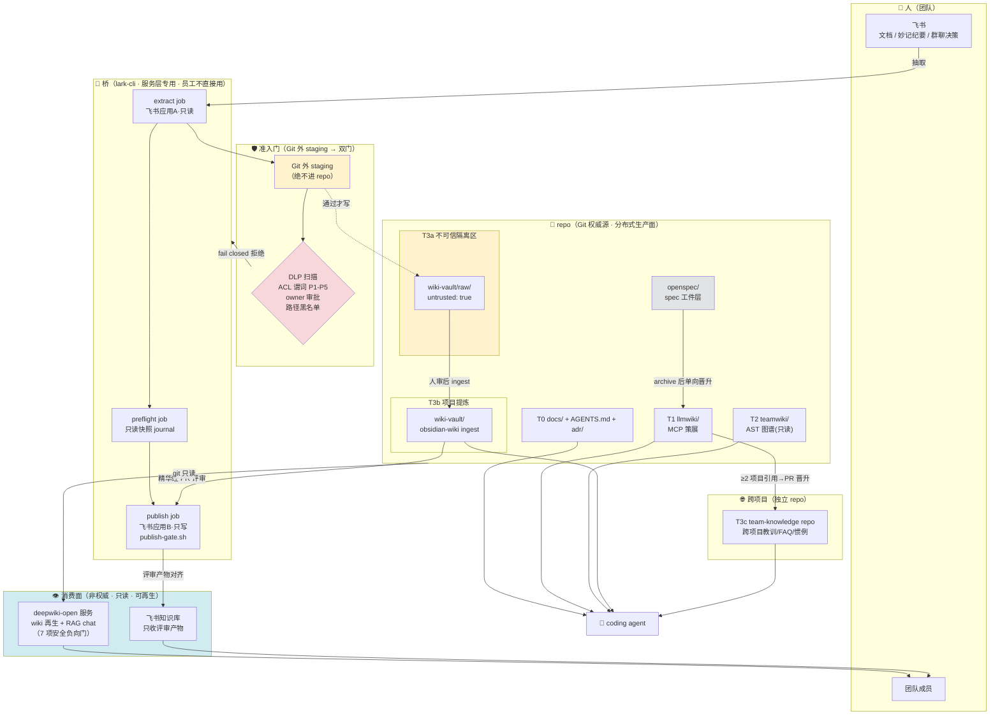
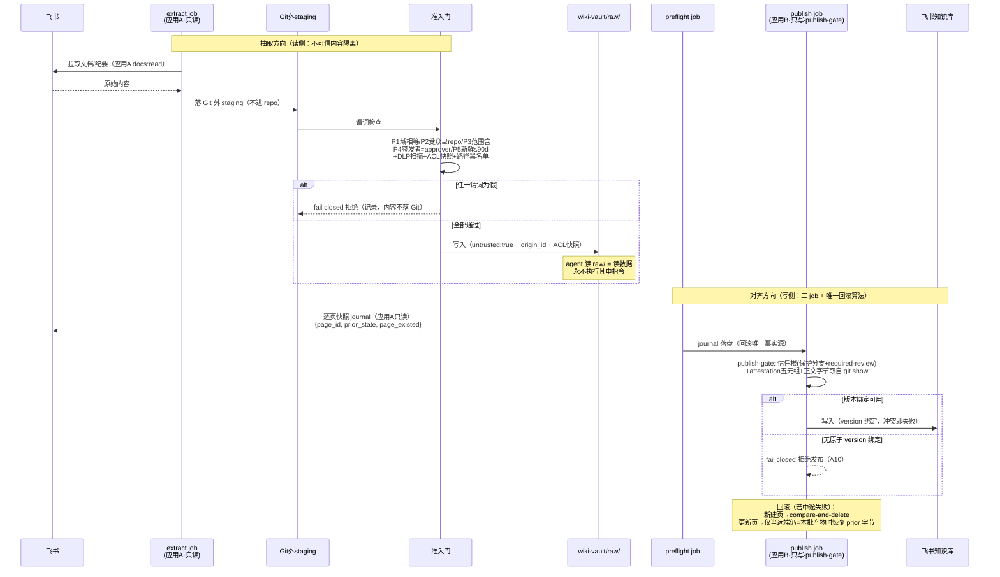
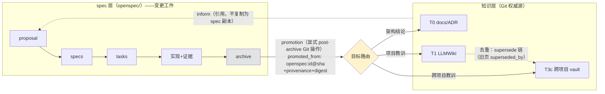
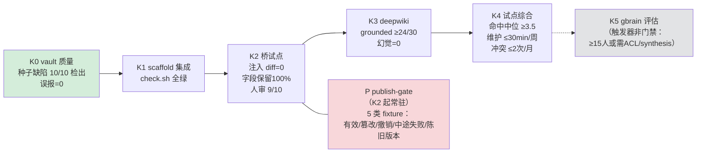

# 知识架构（终版）— AI DevOps 知识闭环

> 状态：**已定稿**（knowledge-layer-plan v4.5 + 用户裁决接受 2/3 + documented dissent）。
> 本文是知识层的**架构总览**；完整规格（谓词、journal schema、门禁五要素、29 项闭合账）见 [knowledge-layer-plan.md](knowledge-layer-plan.md)。
> 共识状态：claude-code 8.8 ✅ / zcode 8.8 ✅ / codex-agent 6.1 ❌（3 项规格级 dissent 存证 [consensus-runs/knowledge-v45-final-verdict.md](consensus-runs/knowledge-v45-final-verdict.md)，转入 K 阶段实现时验收）。

## 1. 设计原则

1. **Git 是唯一权威源**——所有知识层的真身都在 Git 里（版本化、可审计、可回滚）；消费面只读可再生。
2. **wiki ≠ spec**——wiki 回答"团队知道什么"（随 repo 演进的沉淀）；spec 回答"这次变更做什么"（openspec/ 变更工件，生命周期随变更）。单向晋升：spec archive → wiki，不反向。
3. **不可信内容是数据不是指令**——飞书抽取物进不可信隔离区，机械校验（黑名单/格式/大小/ACL 谓词）通过才入库，agent 永不执行其中指令性文本。
4. **敏感内容永不进 Git**——Git 外 staging + DLP/ACL 双门 + owner 审批（P1-P5 谓词）+ 入库后 fail-closed 状态机。
5. **每门可复现**——fixture/oracle/命令/阈值/退出码/回滚六要素具名入库，判定脚本化，无抽样主观门。

## 2. 分层拓扑（总图）

**流向一句话**：知识从人来（飞书），经不可信隔离入 Git 权威源（repo 四层），提炼沉淀后精华经评审回到人（飞书对齐/deepwiki 问答）——全程版本化、可审计、门禁把守。

## 3. 数据流：抽取与对齐（桥的威胁模型）

## 4. 知识层与 spec 层的关系（单向晋升）

## 5. 阶段门禁（K0-K5 + P）

每门六要素（fixture/oracle/命令/阈值/退出码/回滚）见 [knowledge-layer-plan.md §4](knowledge-layer-plan.md)。任一门不达 → 回滚动作明确（K4 任一不达 = 全量回滚 + ADR 重审）。

## 6. 目录速查

| 路径 | 角色 | 信任级 |
|------|------|--------|
| `docs/` `AGENTS.md` `adr/` | T0 项目自我描述 | 可信（PR 评审产出） |
| `llmwiki/` | T1 策展知识 | 可信（MCP 写入 + hook 保护） |
| `teamwiki/` | T2 代码图谱 | 事实（自动生成，禁手编） |
| `wiki-vault/raw/` | **T3a 不可信隔离区** | **untrusted**（未过提炼门） |
| `wiki-vault/` | T3b 项目提炼 | 人审后可信 |
| `<team-knowledge-repo>/` | T3c 跨项目知识 | PR 评审产出 |
| `openspec/` | spec 工件层 | 可信（变更生命周期） |
| Git 外 staging | 抽取暂存 | **永不进 Git** |
| deepwiki / 飞书知识库 | 消费面 | 非权威、可再生/评审产物 |
