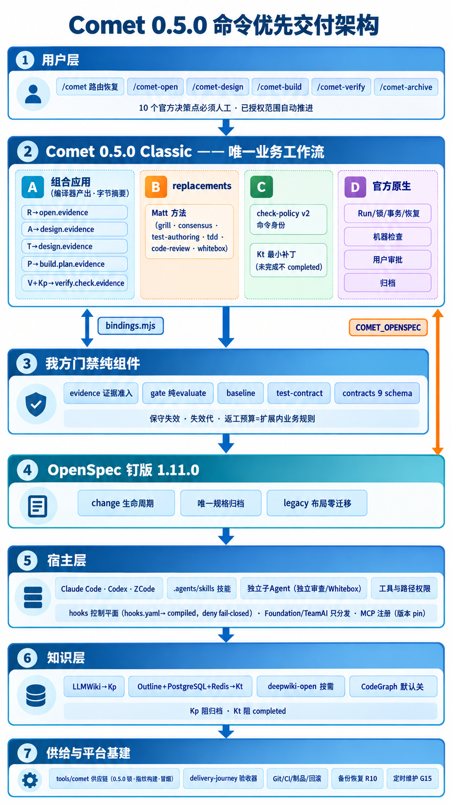
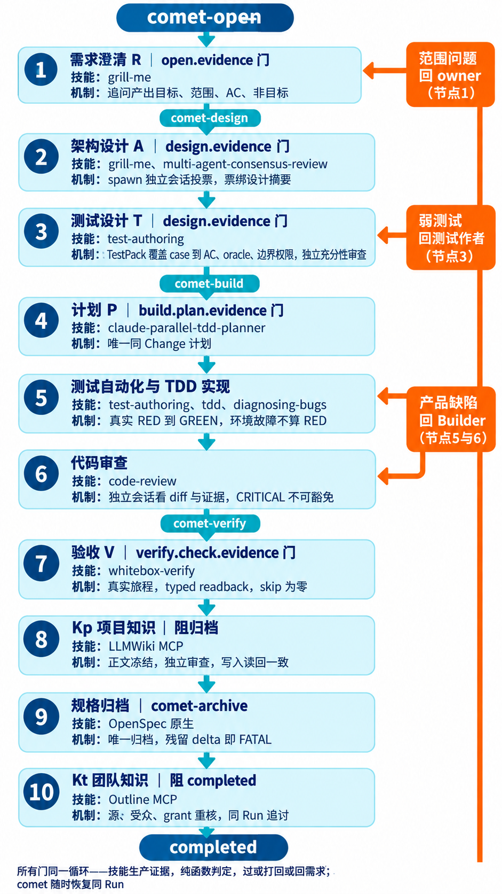

# 提案：升级 Comet 0.5.0，用原生组合能力替代自建补丁链（待批准）

日期：2026-10-26。状态：**提案，未批准，未实施**。配套决策文件：[ADR-0022（Proposed）](../architecture/adr/0022-comet-0.5.0-native-composition.md)。
证据来源：三路并行验证（0.5.0 架构文档 13 份精读 / 0.5.0 tag 源码级核对 / 我方四补丁与全部自建组件逐项盘点），前置调研见 [classic-workflow-deep-dive](2026-10-26-comet-classic-workflow-deep-dive.md)。

## 1. 决策问题

继续 0.4.5 + 0001–0004 补丁链（约 4700 行补丁、深度绑定上游内部），还是升级 0.5.0 用原生组合应用（composition）表达我们的门禁与方法绑定。用户原则：**能少工作量就少工作量，借 API 不借源码，不建平行工作流**。

## 2. 0.5.0 能力验证结论（源码级，带行号）

| 能力 | 结论 | 证据 |
| --- | --- | --- |
| 检查点扩展可阻断 | ✅ 非 pass 裁决打回修复（phase 重置+checkEpoch+1）；必需扩展未过则任何推进被拒；compareAndSusap 对新 action 复验；resume 绕不过 | classic-application.ts L285-543, L715, L753+ |
| 检查点白名单 | `<profile>.open.evidence / full.open.revalidate / full.design.evidence / full.build.plan.evidence / <profile>.build.check.evidence / <profile>.verify.check.evidence`；**无 archive 检查点** | L185-193 |
| 归档期扩展工件复验 | ✅ validateOutcome 拦截含 classic-archive 的一切结果，在归档目录内复验扩展工件哈希，未过则归档结果不被接受 | L621-745, L343-353 |
| 证据绑定协议 | ✅ verdict(pass/repair/revise-requirements)+sourceHash（来源失效即拒）+artifactHashes（实际文件 SHA-256，宿主自报不算） | L285-361 |
| 技能替换 | ✅ replacements 只换 invoke_skill 执行步骤，须保持原输出契约；**机器检查/审批/归档不可替换**（与我不越权原则同向） | L197-205, L386-406 |
| B1 检查身份 | ✅ check-policy v2 原生：必需命令 argv+cwd 字面量注册、独立 entryDigest、SDK 侧逐字校验回执 | classic-check-policy.ts L12-198 等 |
| B4 逃生门 | ✅ 实质失效：COMET_SKIP_BUILD 仅 compat CLI 路径（SDK 检查器 0 引用）；SDK Run 的 state set 限 4 字段且不看 FORCE_PHASE；基础命令不能绕组合检查 | classic-sdk-status.ts L88-90 等 |
| B6 OpenSpec 供应链 | ❌ 仍 `@fission-ai/openspec@latest` 无 pin → 我方隔离钉版 1.11.0 + `COMET_OPENSPEC` 指向仍必需（env 控制，非补丁） | integrations/openspec.ts L555 |
| 0004 安全回填 | ✅ 上游 Vite 已精确钉 8.2.4；其余 backport 0.4.5 upstream 已含；新依赖全部精确 pin → **0004 删除** | package.json + CHANGELOG |
| 状态迁移 | 本仓库 `.comet` 从未初始化 → **迁移成本≈0**；新状态文件 comet-state.yaml；运行数据迁 `~/.comet/workspaces/` | classic-state-file.ts 等 |
| 组合包技能来源 | 应用包自带（contentHash 固定），**不走 `.comet/skills`** → Matt 技能须打进我们的组合包 | workflow-application/application.ts L461-463 |
| 必走编译器 | ✅ 包必须 compileWorkflowApplication 产出（确定性字节摘要）；validators 经包内 bindings.mjs（指向我方 lib/delivery 纯组件） | workflow-generation/compiler.ts |

## 3. 我方资产处置表（升级 0.5.0 方案）

| 资产 | 处置 | 说明 |
| --- | --- | --- |
| 0001（Matt init 改造，41 文件） | **删**（缩为打包配置） | 技能随组合包分发；防复装保留为断言（init/update 不装 Superpowers） |
| 0002（共同硬门，3024 行） | **大幅缩** | R→open.evidence；A、T→design.evidence 两个扩展（绑定 TestPack/设计摘要+独立审查回执）；P→build.plan.evidence；V→verify.check.evidence 业务判据叠加；Kp→verify.check.evidence 扩展（归档期 validateOutcome 复验工件）；rework 预算/失效代→扩展内业务规则；签名 dispatch→对 SDK dispatch 端口 |
| 0003（Kt 阻 completed） | **保留最小后继**（见 §5 开放决策） | 无原生挂点（resolver archived→completed 无条件；工厂拒绝 postarchive 扩展） |
| 0004（安全回填） | **删** | 上游已含 |
| lib/delivery/* 四件 + contracts 九 schema + harness/architecture-review/legacy-evidence | **零改动** | 宿主侧纯组件，经 bindings.mjs 接入组合包 |
| lib/adapters/comet.js / comet-executor.js | **改写** | 新状态文件名 + `comet runtime dispatch` 入口 + SDK 端口重绑 |
| lib/adapters/spec.js | 小改（读回路径） | openspec 归档语义不变 |
| tools/comet/* + upstream.lock.json | 重锁（机械必做） | 新 commit/补丁表/指纹全量重建 |
| test/delivery-cases/2_4,1_6,4_6 | RED 重建 | 断言对象从补丁内部改为组合行为；旧 PASS 不继承 |
| 旧 0.4.5 vendored 构建与证据 | 原样保全 | 历史证据不删 |

## 4. 两方案对比

| 维度 | A：留守 0.4.5+补丁链 | B：升级 0.5.0+组合 |
| --- | --- | --- |
| 自建补丁量 | ~4700 行、4 补丁长期维护 | 1 个最小 Kt 后继（~百行级）+ 打包配置 |
| B1/B4 | 自建扩展 + 人工中和 | 原生解决 |
| 上游方向 | 背离（SDK 是官方主线） | 对齐 |
| 一次性成本 | 0 | 适配器改写+测试重建+供应链重锁（一次性，量级：中） |
| 语义风险 | 维持现状 | 保守失效负例须逐条重放证明等价 |

**推荐 B。** 核心理由：最大的两块自建面（0002 门禁机器、0004 安全）一块转为声明式扩展、一块直接消失；B1/B4 获得原生答案；且本仓库无活跃 Comet 状态，是升级窗口成本最低的时刻。

## 5. 开放决策（需用户拍板）：Kt 语义落点

- **B1（推荐）：保留最小补丁**——0.5.0 resolver 上加 `knowledgeCloseoutBlocked` 谓词（0003 后继，百行级）。保留原语义：归档可先完成，Kt pending 由同 Run 归档后继续发现/推进，Kt 完成才 completed。
- **B2：零补丁纯组合**——把 Kt 也做成 verify.check.evidence 扩展（知识闭环全部前置到归档前）。代价：团队知识（Outline）发布延迟会阻塞整个交付归档，语义变化需接受。

## 6. 批准后的实施顺序（概要，详表待 replan 修订）

1. 供应链：锁 0.5.0（新 commit/完整性/补丁表=仅 Kt 后继）→ prepare/build 全量重建 → 冒烟。
2. 组合包：base=classic-full；replacements=Matt 方法技能；extensions=R/A/T/P/V/Kp；bindings→lib/delivery；check-policy v2 注册必需命令身份。
3. 适配器改写（comet.js/comet-executor.js/spec.js）+ delivery-case RED 重建。
4. 受管 init（经典入口 + 组合包安装；OpenSpec 钉版供应；Superpowers 不复装断言）。
5. 计划面 replan：P2_4/P1_6/P3_4/P1_4 按 §3 处置改写，原任务/场景/检查身份保留、证明方式改绑。
6. 既有暂停现场（P3_1 待提交的重冻结等）在 replan 中一并处置。

## 7. 风险与缓解

- 组合行为与我方语义的等价性：全部保守失效负例（旧摘要拒绝、自写 pass 拒绝、malformed 无回退等）作为迁移差异断言逐条重放，等价才接纳。
- comet-design 可替换性文档未枚举：编译器实测（第一阶段编译验证即出结论，失败则该技能走原版+我方扩展约束）。
- OpenSpec @latest：`COMET_OPENSPEC` 指向隔离钉版 1.11.0，纳入受管启动 env 卫生（hooks 控制平面）。
- 上游 0.5.0 仅机械验证过（synthetic）：我们的验收分母（129/103）不继承，按原 oracle 重跑。

## 8. 合并后的整体架构图（原 command-first 架构 × 0.5.0 提案 × 现有基建）



```text
┌──────────────────────────── ① 用户层 ────────────────────────────────────┐
│  /comet（路由/恢复）  /comet-open  /comet-design  /comet-build            │
│  /comet-verify  /comet-archive    （hotfix/tweak 预设按需）               │
│  · 10 个官方决策点必须人工（设计确认/build三mode/归档五选项…）             │
│  · 已授权范围内 continuation 自动推进（auto_transition）                  │
└──────────────────────────────┬───────────────────────────────────────────┘
                    comet workflow resolve（.comet/config.yaml → classic）
┌──────────────────────────────▼───────────────────────────────────────────┐
│ ② Comet 0.5.0 Classic —— 唯一业务工作流（单主控，无第二状态源）           │
│ ┌─────────────────────────────────────────────────────────────────────┐ │
│ │ classic-full 组合应用（官方编译器产出，确定性字节摘要，可审计）        │ │
│ │  · replacements：Matt 方法技能替换执行技能（保留原 stepId+输出契约）  │ │
│ │  · extensions（可阻断；非pass→repair/revise-requirements）：         │ │
│ │      R ─→ open.evidence        （需求闭合+范围确认）                 │ │
│ │      A ─→ design.evidence      （独立共识，绑定设计摘要）             │ │
│ │      T ─→ design.evidence      （TestPack+独立充分性审查，同点分立）  │ │
│ │      P ─→ build.plan.evidence  （唯一同Change计划，不另起DAG）        │ │
│ │      V ─→ verify.check.evidence（独立Whitebox业务判据，叠加原生检查） │ │
│ │      Kp→ verify.check.evidence （知识正文冻结+写入读回；归档期        │ │
│ │                                 validateOutcome 在归档目录复验工件）  │ │
│ │  · check-policy v2：必需命令身份（argv+cwd 字面量注册+逐字校验）      │ │
│ │  · Kt 后继最小补丁[B1]：Kt 未完成→Run 不 completed（同Run pending）   │ │
│ └─────────────────────────────────────────────────────────────────────┘ │
│  官方原生（不可替换，与我方不越权原则同向）：Run/锁/事务/CAS/恢复、       │
│  领域机器检查、用户审批(Wait)、归档步骤、OpenSpec 深度集成               │
└───┬──────────────────────────────┬───────────────────────────────────────┘
    │ bindings.mjs（validators）    │ 外部 CLI：COMET_OPENSPEC → 钉版
┌───▼───────────────────┐   ┌──────▼───────────────────────────────────────┐
│ ③ 我方门禁纯组件（零升级│   │ ④ OpenSpec（隔离钉版 1.11.0，.sdd/tools）   │
│    成本，原样保留）      │   │    change 生命周期 · 唯一规格归档            │
│ lib/delivery：evidence  │   │    （本仓库根 openspec/ = 官方 legacy 布局） │
│  证据准入 / gate 纯evaluate│  └───────────────────────────────────────────┘
│  / baseline / test-contract │
│ contracts/delivery 9 schema │
│ 保守失效·失效代·返工预算=扩展内业务规则                    │
└───┬───────────────────┘
┌───▼──────────────────── ⑤ 宿主层（Claude Code / Codex / ZCode…）────────┐
│  模型 · 技能(.agents/skills vendored 快照) · 独立子Agent（独立审查/      │
│  Whitebox/共识，真实独立会话） · 工具与路径权限                          │
│  hooks 控制平面（hooks.yaml 唯一策略源→adapter 编译；deny 门 fail-closed）│
│  Foundation / TeamAI：只分发资产（技能/hooks/MCP 注册），不持业务状态    │
│  MCP 能力：mcp-capabilities.yaml → .mcp.json（版本 pin，无绝对路径）      │
└───┬─────────────────────────────────────────────────────────────────────┘
┌───▼──────────────────── ⑥ 知识层（Kp 阻归档；Kt 阻 completed）──────────┐
│  LLMWiki（项目精华，宿主 stdio MCP + 项目数据，.sdd/repos/llmwiki）→ Kp  │
│  Outline + PostgreSQL + Redis（团队知识，.sdd/outline 栈）→ Kt            │
│  deepwiki-open（代码Wiki，按需自托管） · CodeGraph（默认关闭，不阻流程）  │
└───┬─────────────────────────────────────────────────────────────────────┘
┌───▼──────────────────── ⑦ 供给与平台基建 ───────────────────────────────┐
│  供应链：tools/comet（0.5.0 锁+组合包编译+指纹构建+冒烟）；依赖全精确pin  │
│  验收器：tools/verify/delivery-journey（正式场景 proof 级+typed readback）│
│  Git/CI/制品/部署回滚 · 备份恢复（Comet状态+知识DB+附件；R10保留）       │
│  定时维护（既有 CI/宿主调度只触发同 Comet 维护；G15 3分钟发现/2分钟隔离）│
└──────────────────────────────────────────────────────────────────────────┘

退休面（不再出现在图上）：六角色常驻服务 · 私有app-server/RPC · 强制Runner
镜像 · 自建签发/调度/第二账本 · 0004安全补丁（上游已含）· 0001/0002 大部分
（转声明式扩展）。旧 0.4.5 vendored 构建与历史证据原样保全。
```

图例要点：
- ①③⑤⑥⑦ 均为原 command-first 架构（ADR-0021）既有内容，0.5.0 提案不改变它们。
- 变化集中在 ②：Comet 基线 0.4.5→0.5.0，门禁实现从"补丁注入 classic-store"改为"组合应用声明式扩展"，Kt 保留最小补丁（B1）。
- ③④ 是我方最核心资产，升级零成本；④ 同时是 ② 的强依赖（OpenSpec 管 WHAT）。

## 8.1 同一检查点多道门的约束语义（AND，非 OR）

design.evidence 上 A、T 分立，verify.check.evidence 上 V、Kp 分立——约束得住，机制为源码级验证事实：

- 同点多个 extension 按 `order` 排序、**全部必需逐个通过**；任一非 pass，整个转换不发生（classic-application.ts L715），非 pass 裁决打回修复（phase 重置+checkEpoch+1）。
- A/T 是两个独立扩展、各自 verdict+sourceHash+artifactHashes：A 过 T 不过 → 整体 repair，不存在"A 顶掉 T"。设计变更 → sourceHash 失效 → 双双重跑（保守失效原生达成）。
- Kp 阻归档链条四道锁：Kp 扩展不过 → verify 转换不过 → `verify_result=pass` 不存在 → archive preflight 进不去；归档动作 validateOutcome 还会在归档目录内复验扩展工件哈希。
- 绕行面封死：基础 CLI 不能推进组合 Run（须 `comet runtime dispatch`）；SDK Run `state set` 限 4 字段且 FORCE_PHASE 不豁免；resume/compareAndSwap 重验。
- 边界：①"两道门是真实独立会话审的"由③evidence 准入在 validator 内拒绝（同执行者换 role 拒绝等）；②hotfix/tweed 预设的门配策略按 profile 分别声明，preset 升级不能绕过继承检查。

## 8.2 交付执行流程图（技能×机制）



每步同一循环：**入口命令 → 对应技能生产证据 → 纯函数门判定 → verdict 路由**。技能与机制对照：

| 步骤 | 入口 | 技能 | 机制 | 门判什么 |
| --- | --- | --- | --- | --- |
| R 需求 | /comet-open | grill-me | 作者澄清，产出目标/范围/AC/非目标 | 关键问题闭合+owner 确认 |
| A 架构 | /comet-design | grill-me + multi-agent-consensus-review | spawn 独立会话投票，票绑设计摘要 | 票数≥阈值、摘要全匹配、0 自票 |
| T 测试设计 | 同 Design | test-authoring | TestPack（case→AC/oracle/边界/权限/环境）+ 独立充分性审查 | 覆盖 100%、oracle 可判定、三类齐备 |
| P 计划 | /comet-build | claude-parallel-tdd-planner（仅计划） | 唯一同 Change 计划，不派发 | 计划唯一、任务有测试引用 |
| 测试自动化 | 同 Build | test-authoring | 按已审 TestPack 写可执行测试 | 证据经 comet check run 落盘 |
| 实现 | 同 Build | tdd · diagnosing-bugs | 真实 RED→GREEN；环境故障不算 RED | 命令身份由 check-policy v2 注册 |
| 代码审查 | 同 Build | code-review | 独立会话看 diff+证据 | CRITICAL/IMPORTANT 不可豁免 |
| V 验收 | /comet-verify | whitebox-verify | 独立会话真实旅程+typed readback | required 全覆盖、skip=0、读回匹配 |
| Kp 知识 | /comet-archive | LLMWiki MCP | 正文冻结→独立审查→写入读回 | 读回一致；缺失归档四道锁全拒 |
| 规格归档 | 同上 | OpenSpec（原生） | delta 合并主 spec，唯一归档 | 残留 delta 即 FATAL |
| Kt 团队知识 | 同上 | Outline MCP | 源/受众/grant 写前重核→发布读回 | 未完成不 completed，同 Run 追讨 |
| 恢复 | /comet | —（原生） | 状态文件路由，不依赖对话历史 | 断点续走同 Run |

打回路由：弱测试→测试作者；产品缺陷→Builder；范围问题→owner。需求/设计变更使下游全部失效重走。

## 9. 用户接入路径（增量能力分发）

分发物三层：A 宿主基建（foundation 发布视图+FoundationLock，字节级核验）；B Comet 运行时（0.5.0 精确 pin + 组合包，`comet application install`）；C 知识栈（OpenSpec 钉版经 `COMET_OPENSPEC`；LLMWiki 可选；Outline 团队共享部署）。分发只证明资产可解析，不授予业务执行/角色/发布权限。

### 初始 repo（新项目）——scaffold 模板出生

```text
复制本仓库为模板（或团队模板库引用）
  → 自带：AGENTS.md / .agents/skills / hooks.yaml / openspec 骨架 / 工具链
  → bash tools/bootstrap.sh            # hooks装配+技能+MCP（幂等）
  → comet init --workflow classic      # 受管参数：钉版、不装 Superpowers
  → comet application install <组合包> # 门禁+方法绑定生效
  → 用户开始 /comet-open
```

### 存量 repo（已有项目）——增量注入，不接管仓库

```text
① 团队资产库/TeamAI 领取 foundation 分发包（export 产物 + 锁）
② SDD_TARGET_ROOT=<目标项目> bash tools/bootstrap.sh
     # 目标模式（既有实现）：adapter 落地（settings 装配 + compiled env
     # + 技能链接 + 不可变基线封存）；幂等/原子替换/no-follow/用户字段保留
③ comet init --workflow classic
     # 存量项目建 .comet/config.yaml；
     # 已有 openspec/ = 官方 legacy 布局，零迁移兼容；没有则由 init 建立
④ comet application install <组合包>
⑤ 存量代码零改造：Comet change 从 /comet-open 出生，与现有开发并存
```

### 接入后的用户面（开箱即用边界）

- 日常只面对 `/comet` 系命令；门禁拦截呈现为结构化修复指引（如"缺独立测试设计审查回执（绑定设计摘要 …）"），补齐即推进。
- Matt 技能随组合包按阶段自动加载；`comet update` 不触碰钉版供应链（防复装断言+精确 pin）。
- 实施注意（P1_2 范围）：目标模式当前不含目标项目 MCP 注册，需补一步按 `mcp-capabilities.yaml` 注册视图投放 `.mcp.json`；组合包并入 FoundationLock 资产闭包一起分发。
- 前提：`comet-managed-v2` profile 完成资格化（组合包编译验证+真实 R→V）后才对团队分发；此前注入路径不生效。
