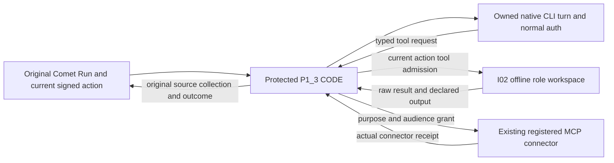

# Minimal original-task CODE and action proposal — not executed

## Model and tool planes

Preferred candidate for review: a fixed **host-native Agent CLI** owns its normal existing authentication and model connection; all product tools go through protected P1_3 CODE into the existing I02 isolated resources or already registered MCP connector. Keep I02 worker networking none. This introduces neither an inference proxy nor a business server. The Agent's bounded thread/turn is an executor session for one original Comet action, never a second delivery Run, phase machine or task queue.

Every arrow after CLI metadata remains a proposal. Current I02 closes stdin after its first frame; current main refuses standalone provider installation and does not read a frame. No interactive tool stream or artifact extraction bridge exists. A thin transport may handle framed input/output, interrupt and collection only; it must not decide phases, create retries, select new roles or own a job queue.

## Bounded CODE contracts

- **Original Comet producer:** supplies the fixed current action/WorkPackage, methods, pre-output input snapshot, actual principal/role/tool/path/purpose grants, output refs and original execution/launch operation. Existing and pending Core owner ports must do this. This adapter cannot derive authority from caller currentActionBinding, a role label or a model command.
- **P1_3 provider:** composes the already owned createCometExecutor/authority/source CODE. For a qualified action only, use a fixed binary/hash and owned stdio app-server process; no shared daemon/proxy fallback. Record child session refs under the original action. Initial candidate configuration uses the actual0.163 schema's environments=[], frozen dynamic tool set and no inherited plugins/MCPs or collaboration/dispatch tools. Unknown tool/approval/permission changes are refused. These configuration properties require live no-bypass proof; no generic dynamic loader or provider URL is accepted.
- **Tool admission:** each typed request is associated with its actual thread/turn/callId and original run/execution/attempt/epoch/revision. Recheck the original action/current inputs and allowed tool/path/purpose before executing. Requests cannot widen a role or install a Host. Human decision requests return through Comet's original decision boundary. The role principal must be independently registered; neither sharing nor changing a model account by itself proves role independence.
- **I02 worker:** receives only controller-authorized work, has no issuer/control state and never installs a controller Host. Its fixed Node handler validates bounded frames and runs only the pre-registered operation/paths in the actual role workspace. Frame JSON cannot select binary/module/image/volume/principal. Existing current dispatch verification occurs in protected controller CODE; do not give workers an HMAC issuer secret to verify themselves. Raw frames alone do not qualify a process or permit an unbound standalone entry to execute on the host.
- **Transport extension needed:** original I02 must review either a bounded request/reply channel on the original handle or an equivalent native execution transport. Its present stdin.end cannot serve iterative Agent tools. Per-tool requests need original Native admission and operation binding; they are not permission to sign new arbitrary jobs outside the Native lock. The existing app-server environment/add WebSocket API is not an already wired stdio route. Do not add a network relay to hide this gap.
- **MCP:** networked MCP calls stay in an already qualified host connector under its purpose/source/target grant. No MCP server is created per tool or method. A model's tool parameters cannot select arbitrary server, audience or credentials. Current app connector tools are not automatically available to a child CLI. Missing registered connector/identity/grant remains UNVERIFIED.
- **SourceReader:** only the protected source path reads actual engine/container/tool terminal and captures trusted protocol events. It obtains original launch/handle/current action from Native, reads immutable raw bytes, and passes them to the original P2_2 collector and independent verifier. It never translates worker pass/role/exit fields into source facts. An unknown or nonzero required terminal blocks acceptance even if TAP/model text says pass.

## Same-Run artifacts across independent role volumes

There is no copy-back implementation today. The current constructor's canonical change path is `<registered projectRoot>/openspec/changes/<change>`; its exact projectRoot is protected registration, not job input. I02 declares role workspaces at `/workspace` and controller workdir `/comet/state/project`, but has not registered a real canonical instance. A read-only source checkout is not silently made writable or replaced with a guessed host path.

| Produced in a role workspace | Canonical target and authority |
| --- | --- |
| `/workspace/openspec/changes/<change>/proposal.md`, design.md, test-intent.md | Same relative declared output under the original registered projectRoot; use that action's original Native author/write permit and exact registered target. Requirements, architecture and test design remain separate. |
| Tests/fixtures and implementation files | Only exact `ActionBinding.outputs[].ref` and original PlanBundle allowedPaths, under the canonical project. Builder cannot replace design, AC, tests or control state outside its permit. |
| TestPack / TestContract / plan artifacts | Use the exact protected current artifact/output refs; symbolic profile names are not paths. Current context supplies TestContract as CODE data and does not supply a universal qualified TestPack filesystem path. Missing exact refs must be registered by the original owner before use, not invented by this adapter. |
| Reports and actual tool transcript | Existing protected controller receipt/artifact storage, with refs/digests bound to the original pending execution. They do not overwrite tasks/DAG/phase or qualify themselves. |

The controlled path is:

1. From the original current action, freeze the pre-output input bytes/digests and declared output targets with their expected prior digest or independently verified absence. Give each role only its allowed snapshot. Record consumed method/version and actual role/process binding, not merely a copied skill file.
2. Original I02/source CODE reads outputs from the **strict original container/role volume handle**. A proposed bounded artifact-read port may copy only declared regular files. It must reject arbitrary container/path, absolute/parent escape, symlink/hardlink/device/extra archive member and truncation. Existing read-only volume/Docker transport must be specifically reviewed; no host mount, Docker socket or model-selected docker cp is granted. Current I02 has no such port.
3. Recheck all pre-output inputs, current action/gates/source and original Native write permission. Apply approved bytes/patches to the canonical target through that protected write surface and compare-and-write against expected prior bytes. The physical controller may perform the copy, but authority is the original author's/Builder's scoped action, not a general controller write bypass. Copying into the right directory does not itself accept an outcome.
4. Read back actual target bytes and bind output digests to the same original pending operation/execution. Preserve the pre-output binding; do not recompute it from the new bytes to make stale work current. For a path that is both input and declared output, Native must distinguish that same operation's before/after bytes. Other input drift is still stale. Current producer support for this rule is pending, not supplied by the adapter.
5. Native consumes the actual outcome and updates its original revision/artifact refs and downstream invalidation. Requirement/design changes expire the approved downstream evidence conservatively. No manual phase/task stamping and no separate promotion ledger is allowed. After a crash, original operation refs plus exact before/after readback determine reconciliation. A target that happens to match proposed bytes without original provenance cannot establish prior success; partial/unknown installs stay blocked and never trigger blind overwrite/retry.

Workers must never supply `.comet.yaml`, `.comet/run-state.json`, locks, authority/issuance/receipt records, global configuration or the migration controller's tasks/DAG as ordinary outputs. Test-authoring and independent Whitebox/review remain separate. The original API must cover authenticated writes, not a plain fs.copy operation with a role string.

## Existing ownership to touch, after separate implementation authorization

P1_3-owned `lib/adapters/comet-executor.js` would bind the provider/frame/SourceReader flow and keep the existing main fail-closed. `lib/adapters/comet.js` would compose the original authority/collector; `harness.js` only if an existing port needs a bounded change. `test/comet-execution-binding.test.js` and relevant existing driver tests would test those seams. No such implementation is written in this intake. If controller/worker CODE cannot be safely separated in that module, propose a single separately owned worker entry before adding a path.

Cross-owner work requires concrete review: I02 runner/registration/role-policy/image/transport/artifact reader; P2_4 original producer/write/install/launch/outcome/recovery record and the reported wrapper-exit/launch-replacement fixes; I01 actual resource/source/purpose/auth-mode qualification. Do not change their files or mark beeff/3056 ports runtime-ready from this report.

## Smallest executable next checks — planned, not run here

1. **Offline CODE:** bounded valid/wrong run/role/attempt/epoch/revision/input frame, malformed/sparse/unknown fields, oversized/partial stdin/EOF and forged binding all exercise the public frame seam. Missing identity/source/grant means zero process, connector call and canonical write. No real credentials or model is needed.
2. **Actual isolated I02 mechanism:** after its image/resource plan is approved, use pinned Node `process.exit(0)` and `process.exit(7)`, plus a test command that prints valid TAP then exits7. Observe attach client, real container and required inner command independently. Mixed0/7 and7/7 cannot pass. SIGKILL/restart/missing inspect/truncated output stay unknown; duplicate request must resolve/observe the original handle without another start.
3. **Artifact mechanism:** a private declared file goes role workspace -> permitted canonical target -> byte readback on the same pending operation. Then test undeclared file, path/link/hardlink escape, concurrent input/target mutation, crash before/after install acknowledgement and restored old input bytes. No false outcome/old receipt revival, extra write or new promotion state is allowed.
4. **Native harness transport, zero inference first:** qualify the exact binary/generated schema/managed config and enumerate its effective tools with inherited plugins/MCP/agents disabled. Prove environments=[] prevents direct host Shell/Edit/file reads and that unknown dynamic/permission/collaboration requests are denied. No login/status or credential extraction is part of this intake; any future startup that can initialize connectors must have its exact resource plan reviewed.
5. **One bounded real Agent action:** only after the owner approves the exact material digest/domain, selected configured provider/account, purpose/audience and allowed tools, run a small declared same-Run author/test or independent review using normal CLI authentication if qualified. No assumption that a new API key is required, and no reuse of the old15-material or Outline once-only authorization. Verify actual Shell/Edit/MCP request, operation/errno, canonical artifact readback, method evidence and independent acceptance. Negative tool/role paths must really fail.
6. **Cold compensation:** kill the original controller at the approved window; recover original launch/handle/three raw refs and canonical install operation. Resolve only original slots; missing bytes/launchId/inputs or unreadable source blocks. Worker cannot take phase, issue grants or start a replacement. Original Comet alone retries or completes after revalidation.

Rollback for these future trials stops only the original registered trial process/operation and preserves evidence/old data; unknown side effects are reconciled before another write. Real model material disclosure, owner auth/grant provisioning, image build/start, actual connector/platform writes and filesystem installation each need the corresponding concrete owner/resource authorization. This plan supplies no such grant.
